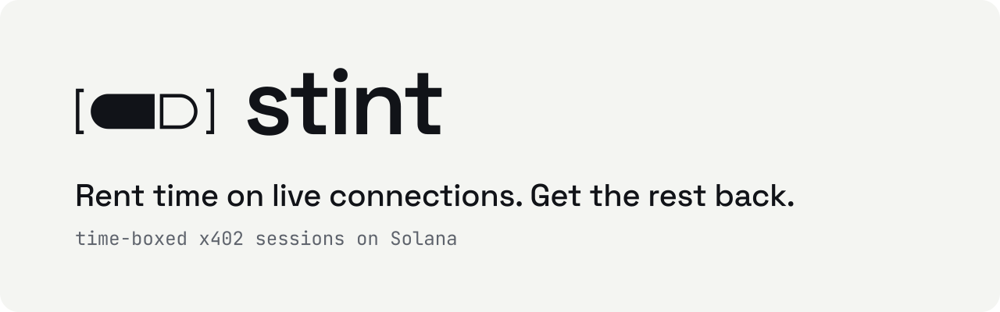

  <picture>
    <source media="(prefers-color-scheme: dark)" srcset="brand/readme-header-dark.svg">
    
  </picture>

Stint is an open-source payment layer that lets AI agents rent time on long-lived connections, and
get back what they don't use:
1. An agent pays once over [x402](https://www.x402.org) to open a time-boxed session.
2. A Solana program releases the payment to the seller as time elapses.
3. If the agent closes the session early, the unused remainder is refunded on-chain.

Brand assets and usage rules: [`brand/`](brand/README.md).

## Development

The toolchain is pinned in `CLAUDE.md` (section "Toolchain") and checked by
`scripts/check-toolchain.sh`. On Windows, work inside WSL 2.

    anchor build                              # build the program
    cargo test -p stint                       # program unit tests
    pnpm install
    pnpm generate:client                      # regenerate the program client after an interface change
    scripts/fetch-subscriptions-program.sh    # fetch and check the Subscriptions program copy, once
    pnpm test                                 # unit and integration tests
    pnpm e2e:local                            # end-to-end scenarios on the local target
    pnpm e2e:devnet                           # the same scenarios on devnet (needs .env.devnet and a deployed program)
    pnpm e2e:devnet funds                     # the address to fund for it, and what that address holds
    pnpm e2e:devnet clean                     # the clean-up alone

The end-to-end report is written to `e2e/report/report.md`.

## MCP server

`@lxfoundry/stint-mcp` serves the session tools over MCP, on stdio, for any MCP host. It is configured
by environment variables, and refuses to start without the caps:

| Variable | Meaning |
|---|---|
| `STINT_KEYPAIR_PATH` | The absolute path of a Solana CLI keypair file, a JSON array of 64 bytes (`~` is not expanded). Required |
| `STINT_MAX_RATE` | The highest rate accepted, in base units per second. Required |
| `STINT_MAX_PER_SESSION` | The most one session may lock, in base units. Required |
| `STINT_BUDGET_AMOUNT`, `STINT_BUDGET_PERIOD_SECONDS` | The most locked across sessions per period. Required |
| `STINT_MAX_MIN_SECONDS` | The highest minimum charge accepted. Default 300 |
| `STINT_SELLERS`, `STINT_PROGRAMS`, `STINT_NETWORKS`, `STINT_ASSETS` | Optional allowlists, comma-separated (`mint:decimals` for assets) |

Every limit is enforced by the client's code, whatever a seller offers or the model asks. The agent's
key holds USDC and no SOL. When the host disconnects, or the process is stopped, every session still
open (and any open still in flight) is closed first, so the unused part of each deposit comes back. The server
waits at most 90 s for that, and then exits with an error.

Register it with an MCP host as a command, from the repository root. For Claude Code:

    claude mcp add stint \
      --env STINT_KEYPAIR_PATH=$HOME/.config/stint/agent.json --env STINT_MAX_RATE=5000 \
      --env STINT_MAX_PER_SESSION=600000 --env STINT_BUDGET_AMOUNT=2000000 --env STINT_BUDGET_PERIOD_SECONDS=3600 \
      -- "$PWD/node_modules/.bin/tsx" "$PWD/packages/mcp/src/cli.ts"

stdout carries the protocol, so the entry point writes nothing else to it. Run the host inside WSL on
Windows, where the toolchain lives.

## Example agent

`examples/agent` gives the session tools to a Claude model through the Anthropic SDK's tool runner, at low
effort, with server-side fallback, and lets it watch a token account on the example stream until a
payment arrives. It takes the same `STINT_*` variables as the MCP server, plus `ANTHROPIC_API_KEY`,
`STINT_GATE_URL` and `STINT_WATCH_ACCOUNT`:

    pnpm e2e:serve:devnet    # starts a stack on devnet, prints the gate's URL and a watched account, pays it every 30 s
    pnpm --filter @lxfoundry/stint-example-agent start

`serve` prints `gateUrl` and `watchedAccount`: copy them into `STINT_GATE_URL` and `STINT_WATCH_ACCOUNT`. The
agent stops once it has worked out the last payment from two consecutive messages about the account.

`STINT_KEYPAIR_PATH` names a keypair file made for the agent that holds devnet USDC and nothing else: do not
point it at the key that deploys the program or at the harness's funding key. Every spending limit is enforced by the client's policy in code. The stream's messages reach the model as
data and cannot raise one. Every session is closed before the agent returns, whatever happened.

## Deploying to devnet

The program is upgradeable on devnet and built verifiably. Both scripts refuse any cluster whose
genesis hash is not devnet's: the Solana CLI's own default is mainnet.

    anchor build --verifiable                  # needs Docker; writes target/verifiable/stint.so
    scripts/deploy-devnet.sh --payer ~/.config/stint/devnet.json --upgrade-authority ~/.config/stint/upgrade-authority.json --program target/verifiable/stint.so --dry-run
    scripts/deploy-devnet.sh --payer ~/.config/stint/devnet.json --upgrade-authority ~/.config/stint/upgrade-authority.json --program target/verifiable/stint.so
    scripts/verify-deployment.sh target/verifiable/stint.so

The payer needs about 1.8 SOL plus fees while the deploy runs, and the script asks for 2.2 (about 0.9 SOL
stays in the program's data account; the buffer's share returns). Run the same command again to upgrade: `solana program deploy`
upgrades in place, and extends the program's data account when the new build is larger. The upgrade
authority is the payer unless `--upgrade-authority` names another key; keep it a key of its own, apart
from the payer, which holds the SOL. Before any
mainnet deployment it must move to a multisig or be revoked.

The program's ID is in `Anchor.toml`; its keypair is `target/deploy/stint-keypair.json` and is never
committed. Back it up.

## Running the scenarios on devnet

`pnpm e2e:devnet` runs the end-to-end scenarios against devnet, with the program deployed by
`scripts/deploy-devnet.sh`. It is run on demand, never as a merge gate: the public network is shared and
rate-limited. Create `.env.devnet` (git-ignored; `.env.example` lists the names) with:

- `STINT_DEVNET_RPC_URL`: a devnet endpoint (and `STINT_DEVNET_WS_URL` if its WebSocket URL is not the
  same address with `ws` for `http`);
- `STINT_DEVNET_SEED`: a recovery phrase of 12 to 24 words in quotes, or 64 hexadecimal characters
  (`openssl rand -hex 32`). Every key of the target derives from it, by the harness's own rule, so the
  addresses are not the ones a wallet shows for the same phrase. Use a phrase made for this, never one
  that holds funds elsewhere, and keep a copy off this machine.

`pnpm e2e:devnet funds` prints the funding key's address and balances. Fund that address once, with at
least 0.5 SOL from a devnet faucet and 5 USDC from Circle's (Solana Devnet). It is the only key to
watch: it plays no part in any scenario, and the fees that runs spend are the only thing that does not
come back to it.

A run checks that the endpoint is devnet and that the program is deployed, then cleans up: it closes
every session that the seed's keys have open and returns what they hold to the funding key. On a first
run there is nothing to do; after a run that was killed it repairs what that run left. Then it funds the
keys it needs from the funding key, runs the scenarios, and cleans up again. `pnpm e2e:devnet clean`
does the clean-up alone. Run one at a time per seed: the clean-up closes every session that the seed's
keys have open, whichever run opened it. A session that an outside key opened, naming the seed's seller
as its receiver, is reported and left alone. If the start-up clean-up fails, the run does not start; `pnpm e2e:devnet --force` goes
on regardless. The report is written to `e2e/report/`. Kora is started with the RPC
URL on its command line, so a URL that carries an API key is visible to other users of the machine (`ps`).
Its log, which a failed run writes to `e2e/report/kora.log` (git-ignored), has every URL cut to its scheme and host.
