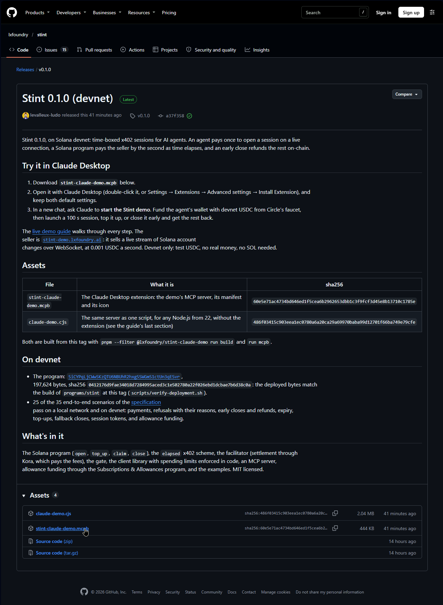
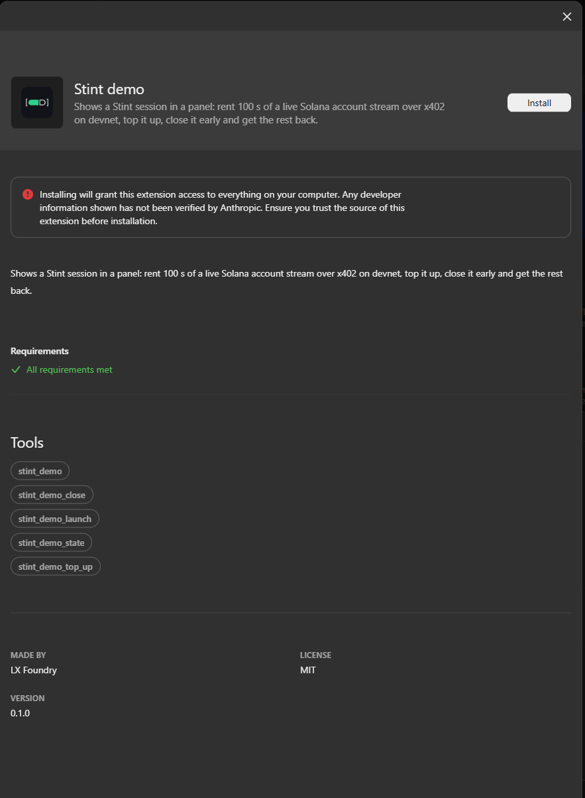
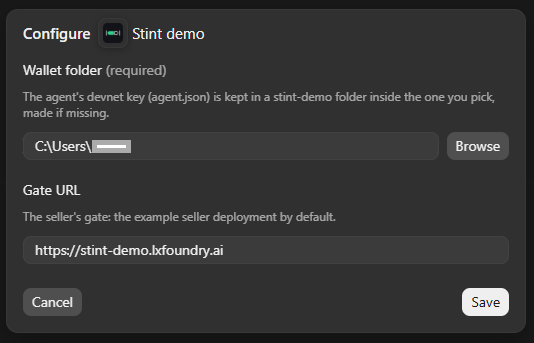
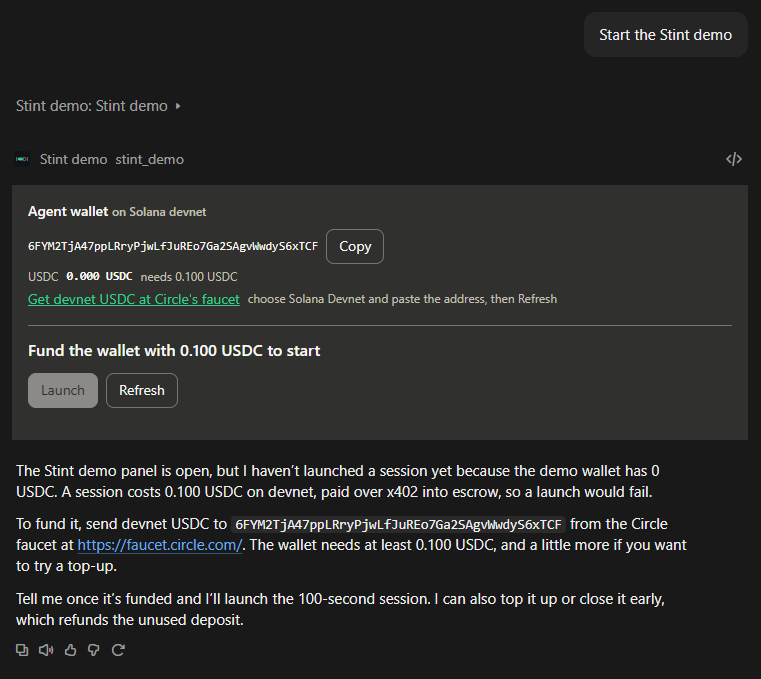
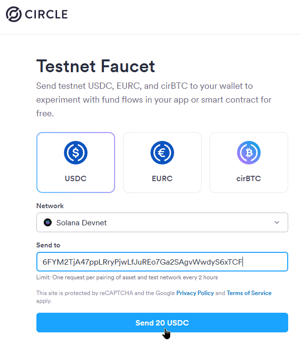
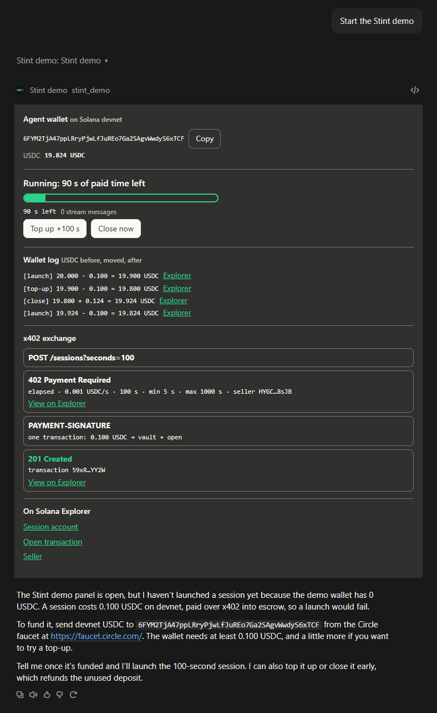
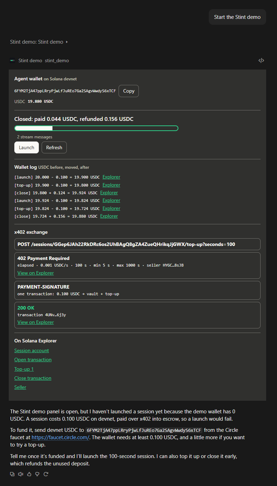

# The live demo: a Stint session in Claude Desktop

An agent rents time on a live data stream, pays for it over x402 from its own wallet, and gets back what it doesn't
use, in a panel inside a Claude Desktop chat. The seller runs on Solana devnet at
[`stint-demo.lxfoundry.ai`](https://stint-demo.lxfoundry.ai). Everything is on devnet: test USDC, no real money.

It takes about five minutes, and needs nothing but Claude Desktop: no Node.js, no command line, no SOL.

## What you need

- **Claude Desktop** on Windows or macOS ([claude.ai/download](https://claude.ai/download)). This guide was checked
  with Claude Desktop 4.4212 on Windows 11.
- A browser, to get test USDC from Circle's faucet.

## 1. Download the extension

Open the [latest release](https://github.com/lxfoundry/stint/releases/latest) of the repository and download
**`stint-claude-demo.mcpb`** from its assets.

## 2. Install it in Claude Desktop

Double-click the `.mcpb` file, or open Claude Desktop's **Settings → Extensions → Advanced settings → Install
Extension** and pick it. Claude Desktop shows the extension, **Stint demo**, and asks for two settings:

| Setting | What to put |
|---|---|
| Wallet folder | Keep the default, your home folder. The extension makes a `stint-demo` folder in it, for the agent's key |
| Gate URL | Keep the default, `https://stint-demo.lxfoundry.ai`, the hosted seller |

Install it, and check that it is enabled.

## 3. Open the panel

Start a **new chat** and ask Claude:

> Start the Stint demo.

Claude calls the extension's `stint_demo` tool. Claude Desktop asks you to allow it: allow it, and the panel appears in
the chat. At its first start, the extension made the agent a new devnet key, and the panel shows its address and its
USDC balance: 0 for now.

## 4. Fund the agent's wallet

1. Copy the wallet's address from the panel.
2. Open Circle's faucet, [faucet.circle.com](https://faucet.circle.com/) (the panel links to it while the wallet holds
   less than 0.100 USDC). Choose **Solana Devnet**, paste the address, and send.
3. Back in the panel, press **Refresh**: the balance shows the USDC.

The wallet needs USDC only. The seller's facilitator pays the network fees through Kora, so the agent never holds SOL.

## 5. Rent time on the stream

Press **Launch**. The agent opens a 100 s session on the seller's stream and pays 0.100 USDC for it, and the panel shows
the exchange as it happens:

1. `POST /sessions?seconds=100`, answered **`402 Payment Required`** with the `elapsed` terms: 0.001 USDC a second,
   from 5 s to 1000 s;
2. the payment, sent in the `PAYMENT-SIGNATURE` header: one transaction that moves the USDC into the session's vault
   and opens the session on-chain;
3. **`201 Created`**, with the settled transaction, linked to devnet's Explorer.

The paid time drains in the panel while the stream is connected. The message count is the stream's updates about the
agent's own USDC account, which arrive when its money moves. The panel subscribes once the session is open, after the
launch's payment has landed, so the count starts with the top-up.

Then, before the paid time runs out:

- **Top up +100 s** buys 100 s more for 0.100 USDC, with the same exchange. A top-up is refused with 13 s or less left,
  and past the seller's longest session, 1000 s.
- **Close now** ends the session early. In one transaction, the program pays the seller for the time used (at least the
  5 s minimum) and refunds the rest to the agent's wallet.

Or let it run out: at the end of the paid time, the gate drops the connection, closes the session, and the seller is
paid in full.

The chat acts on the same session: "top up" or "close it" in the chat calls the same tools as the buttons, and Claude is
asked to quote the wallet's line for what it did.

## 6. Check the money

The panel's **wallet log** has one line per movement of the agent's USDC, such as:

    [launch] 19.924 - 0.100 = 19.824 USDC
    [top-up] 19.824 - 0.100 = 19.724 USDC
    [close] 19.724 + 0.156 = 19.880 USDC

Each line links to its transaction on devnet's Explorer: the payment into the session's vault, and at the close, the
seller's payout and the refund, in the same transaction.

## The limits

The agent spends within limits set in the extension's code, whatever the seller offers or the model asks: at most 0.001
USDC a second, 1.000 USDC per session (an open and nine top-ups) and 2.000 USDC an hour, on devnet USDC only.

## If something goes wrong

| What you see | What to do |
|---|---|
| No panel after "Start the Stint demo" | Check that the extension is enabled, start a new chat, and allow the tool call when Claude Desktop asks |
| Claude declines to top up or close from the chat | Use the panel's buttons, or start a new chat. The buttons call the tools directly, with no model in between |
| Launch is refused | The wallet holds less than 0.100 USDC (press **Refresh** after the faucet), or a session is already running |
| You quit Claude Desktop while a session runs | Claude Desktop stops the extension at once, so it cannot close the session. The stream connection drops, and the seller's gate closes the session 30 s later and refunds the rest. A session with less than 30 s left runs to its end |
| You want the server's log | On Windows (the Store build), `%LOCALAPPDATA%\Claude\Logs\main.log`: the extension's lines follow `[UtilityProcess stderr]` |
| You want to start again with a new wallet | Delete the `stint-demo` folder in the wallet folder. The next start makes a new key; the old one's USDC stays with it |

## Without the extension

The same server runs from one file, `claude-demo.cjs` (also in the release's assets), with Node.js 22 or later, from
Claude Desktop's configuration file: see [Run it without the extension](../examples/claude-demo/README.md#run-it-without-the-extension).

To see the offer without Claude, ask the seller's gate for a session:

    curl -i -X POST https://stint-demo.lxfoundry.ai/sessions

It answers `402 Payment Required`, with the `elapsed` terms in its `PAYMENT-REQUIRED` header.

## Optional: fund the agent from an allowance

Instead of USDC on the agent's key, an owner can grant the agent an allowance on the Solana Foundation's Subscriptions &
Allowances program, a cap per period enforced on-chain. It needs a terminal and Claude Code: see
[An agent funded by an allowance](live-demo-allowance.md).

## How it works

- [`examples/claude-demo`](../examples/claude-demo/README.md): the extension, its panel, the agent's wallet, and why
  two copies of the server share one state.
- [`examples/seller`](../examples/seller/README.md): the hosted seller: Kora, the facilitator with its sweeper, and the
  stream with its gate, on one machine.
- The [specification](specs/stint-system.md): the `elapsed` scheme, the program, the facilitator, the gate and the
  client.
