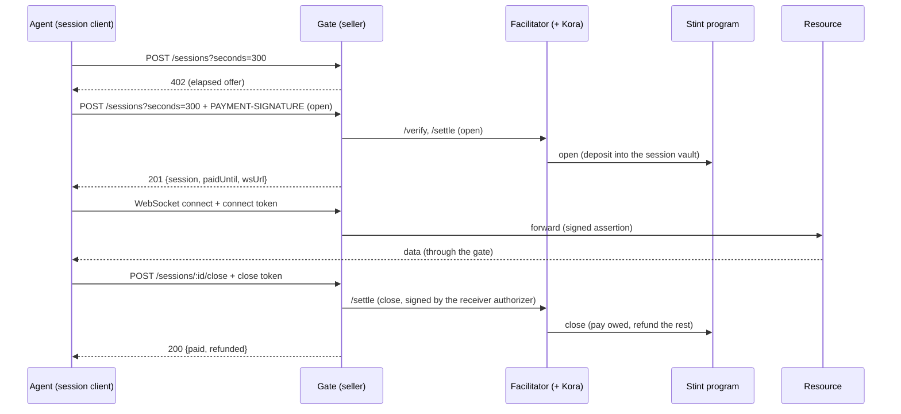

# Stint — system specification

> **Status:** draft 0.2. It describes the system to be built, and it is normative. The wire format
> of the `elapsed` scheme will also be published separately, in the x402 scheme format; once that
> document exists, it takes precedence for the wire format.
>
> The key words MUST, SHOULD and MAY are used as in RFC 2119.

## 1. Overview

Stint lets AI agents **rent time on long-lived connections, and get back what they don't use**.

1. A buyer (typically an AI agent) asks a seller's service for a session and receives an HTTP 402
   response, following the x402 protocol (v2).
2. It pays once, in USDC on Solana, to open a **time-boxed session**. The payment goes into an
   escrow held by the Stint program. The seller receives nothing at this point.
3. The seller is paid **for elapsed time only**, when the session is closed or claimed.
4. When the buyer closes early, the unused remainder is refunded on-chain. When the paid time runs
   out, the connection closes.
5. The buyer can extend a session by topping it up while it runs.

The first resource served this way is a real-time stream of Solana account changes over
WebSocket. The design covers any connection that stays open for minutes or hours, such as a remote
browser.

### Guarantees

- **The seller can never receive more than the elapsed time** (with a minimum duration, set in
  the session's terms, which only the seller can waive) at the session's rate. The one addition is
  the residual described next, if the buyer has closed its refund account (section 4.3).
- **The buyer's unused remainder always returns to the account it came from,** as long as the
  buyer keeps that account. The payout maths is enforced by the program. Once the paid time has
  ended, nothing unused is left, only a residual: a rounding remainder plus any tokens sent to the
  vault by mistake. Both are zero when only exact payments (multiples of the rate) reached the
  vault, as with the facilitator. If the buyer has closed its refund account by then, that
  residual goes to the seller (section 4.3).
- **The buyer can end a session without the seller's gate:** through the facilitator, which
  sponsors the fee, or on-chain with its own SOL. After the session ends, settling it needs
  nobody's cooperation: anyone may do it.
- **No intermediary holds funds.** The facilitator pays transaction fees and fronts account rent,
  but never takes custody of the payment.

### Who integrates Stint

| Integrator | What they use |
|---|---|
| A **service provider** selling a long-lived connection | The scheme package inside an existing x402 server; or the gate middleware (Node); or the gate proxy (a Docker image in front of any WebSocket service) |
| A **facilitator operator** | The scheme's facilitator mechanism; or the ready-to-run facilitator image (with Kora) |
| An **agent developer** | The session client library (with tool definitions and a CLI); or the MCP server |

Everyone shares **one deployed Stint program**, the **`elapsed` scheme specification**, and a
**conformance suite** that checks any implementation of a gate, facilitator or client.

## 2. Terms and Solana background

### 2.1 Terms

| Term | Meaning |
|---|---|
| **Session** | One bounded use of a resource, paid in advance into escrow and settled by elapsed time |
| **Authority** | The buyer's key that controls a session: it signs payments, connection tokens and an optional unilateral close |
| **Receiver** | The seller. `payTo` is its wallet, the final payment recipient; `receiver_token` is the associated token account of `payTo` for the payment mint |
| **Receiver authorizer** | A hot key of the seller's gate, one per resource. It may close a session before its end and waive the minimum charge. It cannot redirect funds |
| **Rent payer** | A facilitator key that funds the session's accounts and gets the rent back when they are closed |
| **Closer** | The key that signs a `close`: the authority, the receiver authorizer, or, after `paid_until`, any key |
| **Gate** | The seller's component in front of the resource: it serves the 402, authenticates connections and enforces the session's end |
| **Facilitator** | The x402 service that verifies and settles session transactions, with Kora as fee payer |
| **Paid until** | The moment the session's deposit runs out at its rate |

### 2.2 Solana facts the design relies on

Many decisions in this specification follow from how Solana stores accounts and tokens. The facts
are listed here once, and the sections that depend on them cite them as (S1) to (S15).

**Accounts and programs**

- **S1. Programs hold no state; accounts do.** Every account has an address, a SOL balance in
  lamports, a data field and an owner program. Only the owner program can change the data or take
  lamports out. *Used in 4.1.*
- **S2. The caller passes in every account an instruction touches,** apart from sysvars such as
  the clock, which a program can read directly. A program cannot look any other account up by
  itself. It must check each account it receives: its address, its owner program and its contents.
  An instruction that accepts a different account than intended (account substitution) is a common
  flaw in Solana programs. *Used in 4.1, 12.*
- **S3. A program-derived address (PDA)** is computed from seeds and a program ID and has no
  private key. Only that program can sign for it. *Used in 4.1.*

**Tokens**

- **S4. Tokens are run by a shared token program, not one contract per token.** This
  specification supports only SPL Token mints (section 3.4). A second program, Token-2022, adds
  extensions that change several facts below (permanent delegates, transfer fees and hooks,
  required memos).
  - A token is identified by its **mint** account, which records supply, decimals, mint authority
    and freeze authority.
  - Balances live in **token accounts**. A holder can have any number of them for one mint; one of
    them may be its associated token account (S7). Each records its mint, its `owner` (the wallet or
    PDA that controls the tokens), its amount, an optional delegate and its state.
  - The token account's owner *program* is SPL Token. Its `owner` *field* is a different thing.
  - Tokens can be received only into an existing token account for the right mint.

  *Used in 4.1, 4.3, 5.1.*
- **S5. Anyone can create a mint.** A token is identified only by its mint address. Apart from
  that address, a token minted a minute ago is indistinguishable from USDC. *Used in 4.6, 5.4,
  7.2, 12.*
- **S6. Anyone can create a token account for any owner.** The creator pays and names the owner,
  who does not sign. A token account whose `owner` is a given wallet or PDA therefore proves
  nothing about who created it or why. *Used in 4.1, 12.*
- **S7. The associated token account (ATA)** of a wallet (or of a PDA) for a mint lives at an
  address derived from (wallet, token program, mint). It is unique and predictable. Anyone can create it, and the
  idempotent create instruction succeeds if it already exists. Creating it requires knowing the
  wallet. *Used in 4.1, 4.3, 5.3, 6.4, 10.1, 11.*
- **S8. A token account has at most one delegate,** allowed to move tokens up to an approved
  amount. *Used in 10.1.*
- **S9. A transfer from a token account to itself succeeds and moves nothing.** *Used in 4.3.*
- **S10. The mint's freeze authority can freeze any token account of that mint.** Nothing can be
  transferred into or out of a frozen account. USDC's mint has a freeze authority, on devnet as on
  mainnet. *Used in 4.6, 6.4, 11, 12.*

**Rent, opening and closing**

- **S11. An account must hold a minimum SOL balance that grows with its size** (rent exemption):
  `(128 + size) × lamports_per_byte` (section 6.3).
  - It is funded by whoever creates the account: a key that signs, or a program for one of its
    PDAs.
  - It is a deposit, not a fee: it is released when the account is closed, to whichever account
    the closer names (S12), not necessarily to whoever funded it. *Used in 4.1, 4.3, 5.3, 6.3, 6.5, 9.1.*
- **S12. Closing an account releases its deposit.** A token account with a zero balance can be
  closed by its `owner` (or its close authority), unless it is frozen (S10).
  - Its whole SOL deposit goes to whichever account the closer names, whoever paid for it.
  - From the next transaction on, the address is empty: no data, owned by the System program. It
    has no lamports either, but anyone can send it some, and it then stays a System-owned account
    with no data. Passed to an instruction, it arrives as such a System account.
  - It can be created again at the same address: by anyone for an associated token account (S7);
    for an account at a keypair's address, only by that key's holder.
  - Wallets often offer to close empty token accounts to reclaim the deposit, so a payout
    destination may not exist when a payout happens.
  - A program closes its own accounts by moving their lamports out. A PDA closed this way can be
    initialized again at the same address.
  - Until then it cannot: creating an account fails (`AccountAlreadyInUse`) while its address holds
    data or belongs to a program. Anchor's `init` relies on this; only `init_if_needed` accepts an
    account that already exists.

  *Used in 4.1, 4.3, 5.3, 6.3, 11.*

**Transactions and time**

- **S13. A transaction is atomic.** If any instruction fails, none of the transaction's effects
  remain. *Used in 4.3, 4.6, 11.*
- **S14. A signature covers the whole transaction, and any instruction in it may use any of its
  signers.**
  - A key that co-signs a transaction someone else built authorizes every instruction in which
    that key appears as a signer. The co-signer must therefore check every place its key appears.
  - The fee payer is simply the first signer. It need not own anything the transaction moves,
    which is how fees are sponsored.

  *Used in 5.3, 5.4, 6.2, 9.1.*
- **S15. `Clock::unix_timestamp` approximates real time.**
  - It is derived from validators' timestamps and bounded around the time expected from the slot
    count, so it can differ from a wall clock.
  - The runtime keeps it from moving backwards, but test harnesses can set it to any value.

  *Used in 4.2, 7.3.*

For readers who know EVM chains, the main differences:

| | EVM (ERC-20) | Solana (SPL Token) |
|---|---|---|
| Token code | One contract per token | A shared token program: SPL Token, or Token-2022, which this specification does not support (S4) |
| Token identity | The contract address | The mint address (S4, S5) |
| A holder's balance | A slot in the token contract's storage | Any number of token accounts per holder and mint, one of which may be the associated token account (S4, S7) |
| Receiving | Possible unless the token blocks the address | Needs a token account for that mint (S4, S7) |
| Storage cost | Gas, paid once; clearing a slot refunds only part of it | A deposit held in the account, released on close to the account the closer names (S11, S12) |
| Which accounts are used | The contract looks them up (`msg.sender`, mappings) | The caller passes them in; the program must check them (S2) |
| Freezing | Only if the token implements it (USDC's blacklist) | Built in, if the mint has a freeze authority (S10) |
| Paying someone else's fees | A relayer or a paymaster | A different first signer: the fee payer (S14) |

## 3. Architecture

### 3.1 Components

| Component | Package / artifact | Responsibility |
|---|---|---|
| **Stint program** | `programs/stint` (Anchor) | Holds each session's escrow; pays by elapsed time; refunds the remainder |
| **Program client** | `@lxfoundry/stint-program-client` (generated by Codama) | Typed instructions and account decoders for `@solana/kit` |
| **`elapsed` scheme** | `@lxfoundry/stint-x402` | The x402 mechanism for client, resource server and facilitator: offers, payloads, verification, settlement |
| **Facilitator** | `apps/facilitator` and a Docker Compose stack (with Kora) | `/verify`, `/settle`, `/supported` for `elapsed`; the buyer's sponsored close; the sweeper |
| **Gate** | `@lxfoundry/stint-gate` (middleware) and `apps/gate-proxy` (Docker image) | Sessions endpoints, connection authentication, end-of-session enforcement, resource adapters |
| **Session client** | `@lxfoundry/stint-client` | The buyer-side runtime, its tool definitions and the `stint` CLI |
| **MCP server** | `@lxfoundry/stint-mcp` | The session tools over MCP |
| **Conformance suite** | `conformance/` | End-to-end scenarios against any gate, facilitator or client |
| **End-to-end harness** | `e2e/` | Starts the whole stack, on a local network or against devnet, and runs the conformance scenarios with control over the chain and the services (section 12.2) |
| **Example resource** | `examples/solana-stream` | A WebSocket stream of Solana account changes |
| **Example agent** | `examples/agent` | An LLM agent that uses a session for a task |

### 3.2 Flow



### 3.3 Repository layout

```
programs/stint/            on-chain program (Anchor)
packages/program-client/   generated client (Codama, @solana/kit)
packages/x402/             the elapsed scheme mechanism
packages/gate/             gate middleware and core
packages/client/           session runtime, tools, CLI
packages/mcp/              MCP server
apps/facilitator/          facilitator service, Compose stack with Kora
apps/gate-proxy/           gate proxy image
examples/solana-stream/    example resource
examples/agent/            example agent
conformance/               conformance suite: the scenario library and its CLI
e2e/                       end-to-end harness: targets, fixtures, report
docs/specs/                specifications
```

### 3.4 Network and token

Devnet first. USDC on devnet is mint `4zMMC9srt5Ri5X14GAgXhaHii3GnPAEERYPJgZJDncDU` (SPL Token, 6
decimals). Only classic SPL Token mints are supported; Token-2022 is out of scope.

### 3.5 Toolchain

| Area | Choice |
|---|---|
| Program | Rust and Anchor; events emitted with `emit_cpi!` |
| Program client | Generated by Codama, for `@solana/kit` |
| Off-chain code | TypeScript on Node.js (an LTS release), in one workspace |
| Tests | LiteSVM for the program; a TypeScript test runner for packages; Surfpool as the local network, embedded in the end-to-end harness (section 12.2) |
| Facilitator stack | Docker Compose, with Kora |
| Kora in tests | The `kora` binary, run as a process by the harness, so every service shares the host's network |
| Transactions | Version 0 transactions, without address lookup tables (section 14) |
| Local start | One command starts the whole stack locally: Surfpool, the facilitator with Kora, the gate, the example resource. The same command can use devnet in place of Surfpool |
| Platform | Linux or macOS. On Windows, WSL 2: the Solana and Anchor toolchains require it, and the embedded Surfpool has no Windows build |
| Continuous integration | The local end-to-end target runs on every push and pull request; the devnet target runs on demand only |

Exact versions, the package manager, the test runner and the build, test and run commands are
pinned by the implementation plan.

## 4. The Stint program

One program instance serves every seller and buyer. There is no global configuration and no seller
registry: each session records its own terms.

### 4.1 Accounts

**Session**: a PDA at seeds `["session", authority, seed]`, where `seed` is a `u64` (little-endian
bytes) chosen at random by the client. About 250 bytes. Only the Stint program can change its data
(S1) or sign for it (S3), which is what makes the program, and nobody else, the escrow's keeper. An
address is unique only while its account exists: after a close, the same `(authority, seed)` could
open again (S12), so clients draw a fresh random seed for every session.

| Field | Type | Meaning |
|---|---|---|
| `version` | `u8` | Layout version |
| `bump` | `u8` | PDA bump |
| `authority` | `Pubkey` | The buyer's controlling key |
| `seed` | `u64` | PDA seed |
| `mint` | `Pubkey` | The payment token |
| `receiver` | `Pubkey` | The seller's wallet (`payTo`). Payouts go to its associated token account, `receiver_token` |
| `receiver_authorizer` | `Pubkey` | The seller's hot key |
| `refund_owner` | `Pubkey` | The wallet whose associated token account, `refund_to`, receives the remainder |
| `rent_payer` | `Pubkey` | The account the rent returns to |
| `rate` | `u64` | Token base units per second |
| `min_seconds` | `u32` | Minimum charged duration |
| `max_seconds` | `u32` | Maximum paid duration |
| `started_at` | `i64` | Unix time at open (`Clock::unix_timestamp`) |
| `deposited` | `u64` | Total credited deposits |
| `claimed` | `u64` | Total paid to the receiver so far |

**Vault**: the associated token account of the session address for `mint` (S7). It holds the
escrowed tokens; anyone can read its balance. Its `owner` is the session PDA, so only the Stint
program can move the tokens out (S3, S4).

Both accounts hold rent deposits fronted by the rent payer (S11). They are closed when the session
closes, and their lamports return to `rent_payer` (S12).

**Account checks, in every instruction.** The caller supplies every account (S2), so:
- `vault` MUST be exactly the associated token account of `session` for `mint`. A token account
  merely owned by the session is rejected, since anyone can create one (S6).
- `receiver_token` and `refund_to` MUST be the associated token accounts, for `mint`, of the
  stored `receiver` and `refund_owner`.
  - The session stores the wallets rather than the token-account addresses because a closed
    account keeps nothing (S12), and recreating an associated token account requires its wallet
    (S7).
  - Their addresses and owners are therefore always known, and anyone can recreate one that was
    closed.
- `rent_payer` MUST equal the stored value.

A mismatch fails with `AccountMismatch`.

### 4.2 Time and amounts

All arithmetic uses checked integers with 128-bit intermediates.

```
covered    = floor(deposited / rate)                  seconds the deposit buys
paid_until = started_at + covered
end        = min(now, paid_until)
elapsed    = max(0, end - started_at)
earned     = min(deposited, rate × elapsed)           what claim may pay out
charged    = max(min_seconds, elapsed)                at close; elapsed alone if the close waives the minimum
due        = min(deposited, rate × charged)           at close: the session's total charge
owed       = max(claimed, due) - claimed              at close: what is still to be paid to the receiver
refund     = vault.amount - owed                      at close
```

`owed` excludes what earlier claims already paid, so it is exactly what the close transfers to the
receiver. `refund` includes the rounding remainder (`deposited mod rate`) and any tokens that reached the
vault without being credited.

`claim` never pays the minimum: it pays `earned - claimed`. Both are running totals since
`started_at`: `earned` is everything earned so far, `claimed` everything already paid out, so each
claim pays only what was earned since the last one. So `claimed ≤ earned ≤ due` at every close,
including one that waives the minimum.

`earned` only grows while the chain's clock does. The runtime keeps that clock from moving
backwards, but test harnesses can set it to any value (S15). The `max(claimed, …)` in `owed`, and a
claim that pays nothing when `earned ≤ claimed`, keep the maths safe either way.

`now` is `Clock::unix_timestamp`. The chain's clock is authoritative for every amount. It can
differ from a wall clock (S15), so off-chain components use their own clocks only to decide when to
act (section 7.3).

### 4.3 Instructions

The program never transfers the buyer's tokens in `open` or `top_up`. The transaction funds the
vault with an earlier instruction (a token transfer, or an allowance pull: section 10), and the
program credits what the vault received. A transaction is atomic (S13), so the funding and the
instruction that credits it succeed or fail together.

**`open(seed: u64, rate: u64, min_seconds: u32, max_seconds: u32)`**

- **Signers:** `authority`, `rent_payer`.
- **Accounts:**
  - `session` (initialized here, its rent deposit funded by `rent_payer`: S11);
  - `vault` (must exist; the associated token account of `session` for `mint`);
  - `mint`;
  - `receiver` (the seller's wallet);
  - `receiver_authorizer`;
  - `refund_owner` (the wallet the funding comes from);
  - token and system programs.
- **Checks:**
  - no session exists at the address. `session` is created with `init`, never `init_if_needed`, so
    an open at the address of a live session fails and leaves it untouched (S12): a seed already
    in use costs the client a retry with a fresh one, never a reset of that session's `claimed` or
    `deposited`;
  - `rate > 0`;
  - `0 < min_seconds ≤ max_seconds`;
  - `receiver` and `refund_owner` are not the session itself. Otherwise a payout account would be
    the vault (S7), a payout to it would move nothing (S9), and the vault could never be emptied
    and closed (S12);
  - `vault.amount ≥ rate × min_seconds`;
  - `vault.amount ≤ rate × max_seconds`;
  - the account checks of section 4.1.
- **Effects:**
  - stores the terms and accounts;
  - `started_at = now`;
  - `deposited = vault.amount`, `claimed = 0`.
- Emits `Opened`.

**`top_up()`**

- **Signer:** `authority`.
- **Accounts:** `session`, `vault`.
- **Checks:**
  - the account checks of section 4.1;
  - `now < paid_until`: a session that has run out cannot be extended, so a buyer never pays for
    a gap;
  - `vault.amount + claimed > deposited`: tokens have arrived since the last credit;
  - `vault.amount + claimed ≤ rate × max_seconds`.
- **Effects:** `deposited = vault.amount + claimed`. Only claims take tokens out of an open
  session's vault, so this adds exactly the newly arrived amount, `vault.amount - (deposited -
  claimed)`.
- Emits `ToppedUp`.

**`claim()`**

- **Signer:** none required. Anyone may call it.
- **Accounts:** `session`, `vault`, `receiver_token`, token program.
- **Checks:** the account checks of section 4.1.
- **Effects:** when `earned(now) > claimed`:
  - transfers `earned(now) - claimed` to `receiver_token`;
  - `claimed = earned(now)`.
- Emits `Claimed`.

**`close(kind: CloseKind)`**

- **Signer:** `closer`.
- **Accounts:** `closer`, `session`, `vault`, `receiver_token`, `refund_to`, `rent_payer`, token
  program.
- **Kinds:**

  | `kind` | Who may sign as `closer` | Charged | Extra check |
  |---|---|---|---|
  | `Standard` | Before `paid_until`: `authority` or `receiver_authorizer`. From `paid_until` on: anyone | `max(min_seconds, elapsed)` | None |
  | `AtExpiry` | Anyone | `elapsed` (equal to `covered`) | `now ≥ paid_until`, else `NotExpired` |
  | `WaiveMinimum` | `receiver_authorizer` only | `elapsed` | None |

  `AtExpiry` is how the gate and the sweeper close at the end. A top-up that lands first moves
  `paid_until`, so the close fails instead of ending an extended session. A gate whose clock runs
  ahead of the chain's simply retries.
- **Checks:** the account checks of section 4.1.
- **Effects:**
  1. transfers `owed` to `receiver_token`;
  2. transfers the vault's remaining balance (the residual) to `refund_to`. From `paid_until` on,
     if `refund_to` no longer exists, the residual goes to `receiver_token` instead and is
     reported as `redirected`. "No longer exists" means **owned by the System program**, whatever
     its lamports (S12). A balance check would not do: anyone can send lamports to the address,
     which would block the redirect and leave the session unclosable. The address can only ever
     hold an SPL Token account or a System-owned one (S7), so this check is complete;
  3. closes the vault and the session, returning their lamports to `rent_payer`.
- Emits `Closed`.

**A transfer of zero is skipped, and its destination need not exist.** Payout accounts belong to
other parties, who can empty and close them at any time (S12), and one failed transfer would fail
the whole close (S13).
- A destination that is owed tokens must exist (S4). If it has been closed, the close fails until
  someone recreates it (S7).
- Whoever closes a recreated account keeps its deposit (S12), whichever payout account it is.
  The facilitator therefore recreates a closed `receiver_token` only because the seller is
  accountable through its API key, which each recreation counts against. It never recreates a
  `refund_to` (section 5.3).
- **After the paid time, a missing refund account never blocks a close.** From `paid_until` on,
  the residual owed to a `refund_to` that no longer exists goes to `receiver_token` (effect 2).
  - By then the deposit has been charged in full, so the residual is only the rounding remainder
    plus tokens sent to the vault by mistake. Both are zero when only exact payments (multiples
    of the rate, as the facilitator requires) reached the vault.
  - Without this rule, a buyer could close its refund account, send one base unit to the vault,
    and leave the session unclosable. Its rent would stay locked, and the seller's earnings
    unpaid.
  - Before `paid_until`, a close that owes tokens to a missing `refund_to` still fails, since the
    unused time belongs to the buyer.
- Frozen accounts are covered in section 4.6.

In Anchor, `receiver_token` and `refund_to` are therefore declared as mutable unchecked accounts
with an `address` constraint on the derived associated token account, not as typed token accounts.
A closed account arrives as a System-owned account with no data (S12), which a typed token account
would reject. SPL Token validates the destination whenever the amount is not zero.

### 4.4 Events

Events are emitted with Anchor's `emit_cpi!`, so they can be read from the transaction's inner
instructions even when its logs are truncated. The gate reads `Closed` to report what was paid and
refunded.

| Event | Fields |
|---|---|
| `Opened` | `session`, `authority`, `rate`, `min_seconds`, `max_seconds`, `deposited`, `started_at`, `paid_until` |
| `ToppedUp` | `session`, `added`, `deposited`, `paid_until` |
| `Claimed` | `session`, `amount`, `claimed` |
| `Closed` | `session`, `kind`, `claimed` (paid by earlier claims), `owed` (paid by this close), `refunded`, `redirected`, `closed_by`, `at` |

### 4.5 Errors

`InvalidTerms`, `DepositTooSmall`, `DepositTooLarge`, `SessionExpired`, `NotExpired`,
`NothingToTopUp`, `Unauthorized`, `MintMismatch`, `AccountMismatch`, `MathOverflow`.

### 4.6 Trust properties and limits

- **The program cannot know the seller's offer.** Terms are proposed by the buyer and stored
  as signed. The program accepts any mint, and anyone can create one (S5), so the mint is one of
  those terms. The facilitator (before settling) and the gate (before serving) check that a
  session's terms, mint included, match the offer. A session with other terms is never served.
  Its buyer can close it through the facilitator's sponsored close or on-chain (section 5.3).
- **`refund_owner` is supplied by the client.** The session client always sets it to the owner of
  the account the funds came from. When the vault is funded through an allowance (section 10), the authority
  key is the allowance's delegate. If it is compromised, it can pull up to the period's cap to any
  destination, not only point refunds elsewhere. The cap and the delegation's expiry bound that
  exposure.
- **Frozen accounts.** USDC's mint has a freeze authority (S10).
  - If it freezes `receiver_token` or `refund_to`, a close that owes that account tokens fails
    (S13) until the account is thawed. A close that owes it nothing still settles.
  - If it freezes the vault itself, no `claim` or `close` can move tokens out until the vault is
    thawed.

  In both cases the funds stay in the vault meanwhile.
- **Upgrades:** the program is upgradeable on devnet, built verifiably. Before any mainnet
  deployment, its upgrade authority MUST move to a multisig or be revoked.

## 5. The `elapsed` x402 scheme

### 5.1 The offer (`PaymentRequirements`)

Standard x402 v2 fields, with the scheme's terms in `extra`.

```json
{
  "scheme": "elapsed",
  "network": "solana:EtWTRABZaYq6iMfeYKouRu166VU2xqa1",
  "amount": "150000",
  "asset": "4zMMC9srt5Ri5X14GAgXhaHii3GnPAEERYPJgZJDncDU",
  "payTo": "<receiver wallet>",
  "maxTimeoutSeconds": 60,
  "extra": {
    "paymentFlow": "escrow",
    "action": "open",
    "programId": "<stint program>",
    "rate": "500",
    "seconds": 300,
    "minSeconds": 60,
    "maxSeconds": 3600,
    "receiverAuthorizer": "<gate hot key>",
    "feePayer": "<fee payer>",
    "rentPayer": "<rent payer>",
    "closeUrl": "https://facilitator.example/close",
    "recentBlockhash": "<blockhash>",
    "lastValidBlockHeight": "<height>",
    "idleCloseSeconds": 60,
    "closeOnOutage": true
  }
}
```

| Field | Meaning |
|---|---|
| `amount` | **The exact deposit** for this entry: `rate × extra.seconds`, in base units |
| `payTo` | **The final payment recipient.** The deposit goes into the session's escrow first; `payTo`'s associated token account for `asset` receives only what `close` or `claim` pays out. Tokens can be received only into an existing token account (S4), so it MUST exist when the session opens: the facilitator checks this, since the program does not |
| `extra.paymentFlow` | `"escrow"`: the deposit is committed before the resource runs, and a second settlement records the final charge. In `elapsed`, that second settlement happens at close, on a later request (section 5.5) |
| `extra.action` | `"open"`, or `"topUp"` with `extra.session` set to the session address. `"close"` appears only in the requirements the gate sends with a close (section 5.5), never in an offer |
| `extra.rate`, `seconds`, `minSeconds`, `maxSeconds` | The session's terms |
| `extra.receiverAuthorizer` | The gate's hot key for this resource, stored in the session |
| `extra.feePayer`, `extra.rentPayer`, `extra.closeUrl` | Published by the facilitator in `/supported`. Servers MUST copy them from there and MUST NOT hard-code them. `closeUrl` is the facilitator's sponsored close for buyers (section 6.1) |
| `extra.recentBlockhash`, `extra.lastValidBlockHeight` | Advisory: they let a client without access to a Solana node build its transaction. `maxTimeoutSeconds` MUST NOT exceed the time the blockhash still has left when the offer is issued |
| `extra.idleCloseSeconds`, `extra.closeOnOutage` | The gate's buyer-protecting policies (section 7.5) |

**Number encoding.** `u64` values (`amount`, `rate`, `lastValidBlockHeight`) are decimal strings.
`u32` values (`seconds`, `minSeconds`, `maxSeconds`, `idleCloseSeconds`) are JSON numbers.

**Decimals.** `TransferChecked` needs the mint's decimals, which are stored in the mint account
(S4). Clients take them from their asset
allowlist, which records each allowed mint with its decimals, so no node access is needed.

Network identifiers: devnet `solana:EtWTRABZaYq6iMfeYKouRu166VU2xqa1`, mainnet
`solana:5eykt4UsFv8P8NJdTREpY1vzqKqZKvdp`.

### 5.2 Durations

- A request MAY carry `seconds` (open and top-up).
- Without it, the 402 lists **one `accepts` entry per duration** in the seller's configured menu
  (by default, `minSeconds` alone). For a top-up, only the durations that still fit are listed.
- With it, the 402 lists exactly that duration.
- Valid durations:
  - for an open, `minSeconds`…`maxSeconds`;
  - for a top-up, 1…(`maxSeconds` − the seconds already covered); `minSeconds` does not apply.
- A duration outside these bounds is refused with `400 invalid_duration`, with the bounds stated
  in the body.
- **A client cannot deposit more than the `amount` of the entry it accepts.** To pay more it asks
  for a longer duration, picks a longer entry, or tops up.

### 5.3 Actions and payloads

| Action | Initiated by | x402 handshake | Payload `type` | Transaction signed by the client |
|---|---|---|---|---|
| Open | Client | 402, then retry with `PAYMENT-SIGNATURE` | `open` | Yes |
| Top up | Client | 402, then retry with `PAYMENT-SIGNATURE` | `topUp` | Yes |
| Close | Gate: on the client's authenticated request, at expiry, after idling, on a resource outage, or on an admin command (section 7.3) | None: it is not a payment | `close` | No: signed by the receiver authorizer |
| Sponsored close | Client, when the gate cannot close: sent to `extra.closeUrl` | None | `close` | Yes: signed by the authority |
| Unilateral close | Client, submitted on-chain directly, paying its own fee | None | — | Yes: signed and paid by the authority |

**Client payload** (`PAYMENT-SIGNATURE`, base64 JSON):

```json
{
  "x402Version": 2,
  "resource": { "url": "https://gate.example/sessions" },
  "accepted": { "...": "the chosen entry, exactly as received" },
  "payload": { "type": "open", "transaction": "<base64, partially signed>", "session": "<address>" }
}
```

- `accepted` MUST be the chosen entry exactly as received, byte for byte.
- `x402Version` MUST be 2.
- `payload.session` is informative: the facilitator derives the address itself.

**Transaction layouts.** Transactions are version 0. The fee payer is the first account and is
left unsigned by the client: the facilitator pays the fees, and the client holds no SOL (S14).

| Type | Instructions, in order |
|---|---|
| `open` | [compute budget, optional] → create the vault, idempotent (S7), its rent deposit funded by `rentPayer` (S11) → **exactly one** funding instruction: a `TransferChecked` from the authority's associated token account (or one allowance pull, section 10) into the vault for exactly `amount` → `stint.open` |
| `topUp` | [compute budget, optional] → exactly one funding instruction into the vault for exactly `amount` → `stint.top_up` |
| `close` | [compute budget, optional] → [recreate a closed `receiver_token` that is owed tokens, idempotent, funded by `rentPayer`; optional] → `stint.close`, whose `closer` is `receiverAuthorizer` (gate), the authority (sponsored close) or the rent payer (sweeper) |

**Where the facilitator's keys may appear.** The facilitator co-signs transactions that clients
build, and its signature authorizes every instruction in which its key appears as a signer (S14).
Its keys are therefore confined:
- **the fee payer** only as the fee payer: in no instruction's accounts, and as no program;
- **the rent payer** only as:
  - the funder of an idempotent associated-token-account creation: the vault at open, or a closed
    `receiver_token` at close, never a `refund_to`;
  - `stint.open`'s `rent_payer`;
  - `stint.close`'s `rent_payer`, which receives lamports and does not sign;
  - and, in the sweeper's own transactions, the `closer`.

  It is never an authority, a token-account owner, a transfer source or any other account. The
  rent payer signs open transactions, close transactions in which it recreates `receiver_token`,
  and the sweeper's closes.

**Recreating an account is a cost, not an advance.** The creator pays the new account's deposit
(S11), but its owner gets that deposit when it closes the account (S12). A buyer could close its
refund account, have the facilitator recreate it, and pocket the deposit, over and over. The
facilitator therefore never recreates a buyer's `refund_to`. It recreates
a seller's `receiver_token` only when the seller is owed tokens, and counts each recreation against
the seller's API key (section 6.5). Sponsored and sweeper closes carry no API key, so when an open
settles, the facilitator records which API key it came through.

### 5.4 Verification (facilitator `/verify`)

`/verify` MUST be read-only: it simulates and never submits.

**Every type:**

- **Payload:** `x402Version` is 2; `scheme`, `network` and `asset` match (the asset is a mint
  address, the only thing that identifies a token: S5); `accepted` equals the issued entry
  exactly.
- **Fee payer:** it is `feePayer`, the first account, unsigned (S14).
- **Facilitator keys:** the fee payer and the rent payer appear only where section 5.3 allows.
- **Allowed programs:** compute budget, associated token account, SPL Token, Stint, and the
  allowance program (section 10).
- **Simulation** (including inner instructions):
  - the transaction succeeds;
  - the fee payer is debited only the fee;
  - the rent payer funds only the session and vault accounts, or a recreated `receiver_token`.
- **Blockhash:** still valid.
- **Requirements:** compared with the requirements **issued by the resource server**, never with
  the client's echo of them.

**Per type:**

| Type | Checks |
|---|---|
| `open` | The `stint.open` terms equal `extra` (`rate`, `minSeconds`, `maxSeconds`), and `receiver_authorizer` equals `extra.receiverAuthorizer`. `receiver` is `payTo`, and its associated token account for `asset` exists. `refund_owner` owns the associated token account the funding comes from. `rent_payer` is `rentPayer`. The funding moves **exactly `amount`** of `asset` into the vault. The authority signed |
| `topUp` | The session exists and its terms match the gate's offer. The signer is its `authority`. `paid_until` is at least 10 s away, so the transaction lands before the end. The funding moves exactly `amount`. The total stays within `maxSeconds` |
| `close` (from the gate, through `/settle`) | The session exists and its terms match the requirements. The `closer` is its `receiver_authorizer` |
| `close` (sponsored, through `closeUrl`) | The session exists and its `rent_payer` is one of this facilitator's keys. The `closer` is its `authority`, and `kind` is `Standard` or `AtExpiry`. The payload, `accepted` and requirements checks do not apply: the request carries only the transaction. The fee-payer, facilitator-key, program, layout, simulation and blockhash checks do |

Refusals return `isValid: false` with one of these reasons. Where x402 defines a standard reason,
it is used.

| Reason | Meaning |
|---|---|
| `invalid_x402_version` | `x402Version` is not 2 |
| `invalid_payload` | The payload or its transaction cannot be decoded |
| `invalid_payment_requirements` | `accepted` differs from the issued entry, or the scheme, network or asset differ |
| `invalid_terms` | The terms differ from the offer |
| `invalid_amount` | The funding is not exactly `amount` |
| `unexpected_instruction` | An instruction outside the allowed layout |
| `payer_misuse` | The fee payer or the rent payer appears where section 5.3 forbids it |
| `blockhash_expired` | The transaction's blockhash is no longer valid |
| `session_expired` | A top-up after `paid_until` |
| `simulation_failed` | Including an exhausted allowance |
| `unknown_session` | No such session |

### 5.5 Settlement (facilitator `/settle`)

1. Re-verify.
2. The rent payer signs (`open`, and a `close` that recreates `receiver_token`).
3. Kora signs as fee payer.
4. Submit, and wait for `confirmed`.

The response follows x402 v2:
- `success`, `transaction`, `network`;
- **`payer` = the session authority** (not the fee payer);
- `amount`: for `open` and `topUp`, the amount deposited; for `close`, the amount the close paid
  the receiver;
- `settlement_pending` is a non-final `errorReason`, accompanied by a non-empty `transaction`.

Servers MUST derive the payer from the signed transaction, not from the response.

**A close through `/settle`.** The gate sends:
- `paymentPayload` with `payload.type: "close"` and the close transaction, signed by its
  receiver authorizer;
- `paymentRequirements`: the gate's offer for the session's terms, with `amount: "0"` (a close
  deposits nothing), `extra.action: "close"` and `extra.session` set.

The gate takes `paid` and `refunded` from the `Closed` event in the confirmed transaction:
`paid` is `claimed + owed + redirected`, and `refunded` is `refunded`.

**Payment flow.** `elapsed` declares `escrow`: open is the first settlement (the deposit), close is
the second (the final charge and the refund). Unlike a single-request escrow flow, the second
settlement happens on a later request, or after expiry. So the gate drives both settlements itself
rather than through a per-request middleware flow.

**Idempotency.** A session address is unique per `(authority, seed)` while it exists, and a
signed transaction cannot land twice. A retried settlement whose transaction has already landed is
reported as a success, with the same session.

### 5.6 Optional `exact` fallback

There is no x402 rule that makes clients skip a scheme they don't know. A seller MAY therefore add
a plain `exact` entry to the same `accepts` list:
- a fixed pass for a fixed duration, with `paymentFlow: "upfront"` and no refund;
- the difference stated in `resource.description`.

The gate does not build this fallback yet.

## 6. The facilitator

### 6.1 Interface

Standard x402 facilitator endpoints, for resource servers, with an API key:

| Endpoint | Behaviour |
|---|---|
| `/verify` | As section 5.4 |
| `/settle` | As section 5.5 |
| `/supported` | Lists, in `kinds`, `{x402Version: 2, scheme: "elapsed", network, extra: {feePayer, rentPayer, programId, closeUrl}}` |

One endpoint for buyers, without an API key:

| Endpoint | Behaviour |
|---|---|
| `GET /close` (the `closeUrl`) | What a client needs to build a close without access to a Solana node: `{feePayer, recentBlockhash, lastValidBlockHeight, programId}`, current at the time of the request. With `?session=<address>`, also the session's stored fields |
| `POST /close` (the `closeUrl`) | The **sponsored close**. Body: `{transaction}`, a `close` transaction signed by the session's authority. Accepted only for sessions whose `rent_payer` is one of this facilitator's keys. Verified as in section 5.4 (sponsored row) and settled as in section 5.5. Returns `{success, transaction, paid, refunded}`, with `paid` = `claimed + owed + redirected` from the `Closed` event, as for the gate |

Both are rate-limited per session and per client address. `GET` serves a blockhash cached for a few
seconds, so unauthenticated requests do not each reach the node.

Together they let a buyer that holds no SOL, and has no node access, leave a session when the
seller's gate is unreachable.

### 6.2 Kora

Kora runs beside the facilitator and is reachable only by it, with an API key.

- **Policy:**
  - allowed programs as in section 5.4, plus the System program, which account creation invokes.
    Kora applies its program allowlist and its fee-payer policy to the inner instructions of the
    simulated transaction as well, so every program reached through a call from another program
    must be listed (to be confirmed at run time: section 14);
  - the fee payer may not transfer SOL or tokens, create accounts, or act on token accounts:
    its signature would otherwise authorize any of these in a client-built transaction (S14);
  - a cap on lamports per transaction.
- **Pricing:** `free` (fees sponsored).
- **Several signers** MAY be configured to spread fee-payer write locks.

### 6.3 Keys and costs

| Cost | Who pays | Amount | Recovered |
|---|---|---|---|
| Transaction fees | The fee payer (Kora) | 5,000 lamports per signature. A typical session costs about 3 transactions | No (sponsored) |
| Rent for the session and vault accounts (S11) | The rent payer | `(128 + size) × lamports_per_byte` per account, read from the chain | Yes, at close (S12) |

The rent payer MAY be a pool of keys: each session records its own `rent_payer`. Keys are loaded
from the environment or a mounted volume.

### 6.4 The sweeper

The sweeper periodically lists sessions whose `rent_payer` is one of this facilitator's keys and
whose `paid_until` has passed, and closes them with `close(AtExpiry)`, the rent payer signing as
`closer`:
- the rent returns to the facilitator;
- the receiver is paid;
- the buyer gets any residual, or the receiver does if the buyer has closed its refund account
  (section 4.3).

If the receiver is owed tokens and `receiver_token` has been closed, it recreates that account in
the same transaction (S7). It never recreates `refund_to` (section 5.3), and never needs to: after
`paid_until`, a residual owed to a closed refund account goes to the receiver (section 4.3). Every
expired session therefore closes, and its rent comes back. A close that fails because an account
is frozen (S10) is retried with an increasing back-off.

It runs on one elected instance, or on all of them tolerating duplicates: a second close finds the
account gone and is skipped.

### 6.5 Packaging and configuration

A Docker Compose stack: the facilitator, Kora and a configuration template.

| Setting | Meaning |
|---|---|
| `RPC_URL`, `NETWORK`, `PROGRAM_ID` | Where and what to settle |
| Key paths | Fee-payer and rent-payer keys |
| API keys | One per resource server; REQUIRED on `/verify` and `/settle` by default |
| Limits per API key | Open sessions, rent fronted, recreated receiver accounts, and the session horizon: offers with a `maxSeconds` above the cap (default 86,400 s) are refused |
| Rate limits | Per API key and per authority; for `/close`, per session and per client address |
| Seller allowlist | Optional, for hosted operators |
| Sponsorship policy | Who pays fees (sponsored by default) |

Fees are sponsored and rent is fronted, and a deposit comes back only when its account closes
(S11). An anonymous resource server could therefore make the facilitator lock rent in long
sessions it opens with itself. The API key and the limits per key bound that.

## 7. The gate

### 7.1 HTTP and WebSocket surface

| Endpoint | Purpose | Responses |
|---|---|---|
| `POST /sessions?seconds=N` | Open | `402` (offers); `201 {session, paidUntil, wsUrl}`; `400 invalid_duration` |
| `POST /sessions/:id/top-up?seconds=N` | Top up | `402`; `200 {paidUntil}` |
| `POST /sessions/:id/close` | Normal close, with a `close` token | `200 {paid, refunded, transaction}`; `401`; `404`; `409 refund_account_closed` (the buyer's `refund_to` is closed and owed tokens) |
| `GET /sessions/:id` | Status from the chain: `paidUntil`, deposited, earned so far, time left, a fresh blockhash | `200`; `404` |
| `GET /sessions/:id/ws` | WebSocket upgrade, with a `connect` token | Upgrade; `401`; `402` (the session has ended or is within the margin of its end: offers for a new session); `403`; `404`; `503` |
| `GET /.well-known/jwks.json` | The gate's assertion keys (section 7.7) | `200` |

- The `201` and `200` responses to open and top-up carry the `PAYMENT-RESPONSE` header.
- Every check on a WebSocket connect runs before the upgrade and fails with an HTTP status. Close
  codes (section 7.4) apply only to connections already open.
- **One gate per resource.** A gate (all of its instances), or a middleware mount, sells one
  resource and has one receiver authorizer, shared by its instances. Every session records that
  key, so a session opened for one resource is never accepted by another.
- TLS (`https`, `wss`) is REQUIRED except on localhost.

### 7.2 The session token

A short-lived JWS signed by the session's `authority` with its Ed25519 key.
- **Algorithm:** clients emit `alg: Ed25519` (RFC 9864); gates accept `Ed25519` and the older
  `EdDSA`.
- **Signing:** the signature covers the raw JWS signing input, with no message envelope added by
  the signer.

| Claim | Value |
|---|---|
| `sub` | The session address |
| `aud` | The gate's origin |
| `purpose` | `connect` or `close` |
| `iat`, `exp` | `exp` at most 120 s after `iat` |
| `jti` | A unique id |

- **Produced by:** the session client, immediately before each request that needs it. The gate
  never issues anything.
- **Required on:**
  - every WebSocket connect and reconnect (`purpose: connect`);
  - the close request (`purpose: close`).
- **Not required on:** open and top-up, which are authenticated by the signed payment transaction;
  status, which is public.
- **Carried in:** `Authorization: Bearer <token>`, or `?token=<token>` for clients that can only
  pass a URL. The gate removes it before forwarding and never logs it.
- **Gate checks:**
  1. the signature is from the session's on-chain `authority`;
  2. `aud` and `purpose` match, and `exp` has not passed (with 30 s of tolerance for clock skew
     on `iat` and `exp`);
  3. `jti` has not been seen before;
  4. the session's terms match one of the gate's offers (program, `mint` equal to the offer's
     `asset`, `receiver`, `receiver_authorizer`, rate, bounds). The mint matters: anyone can
     create a mint (S5) and the program accepts any mint, so a session opened directly on-chain
     in a token the buyer minted itself would otherwise match;
  5. `paid_until` is more than the margin away (default 2 s).

### 7.3 Session lifecycle in the gate

**From open to end.** When an open settles, the gate provisions the resource and subscribes to the
session account at `confirmed` commitment. It stays subscribed until the session ends, whether or
not a connection is live.

| Trigger | Gate action | `close` kind |
|---|---|---|
| Open settled | `provision()`; subscribe; start the idle timer and the end timer | — |
| `provision()` fails | Treated as a resource outage: close | `WaiveMinimum` |
| Connect for a session this gate has not seen (opened directly on-chain, passing every check of section 7.2, including the mint, and with this gate's receiver authorizer) | Adopt it as if its open had just settled, then accept the connection | — |
| Connection accepted | `attach()`; stop the idle timer | — |
| Last connection drops | Start the idle timer (`idleCloseSeconds`) | — |
| Idle timer fires (never connected, or not reconnected) | Close | `Standard` |
| The buyer's close request | Drop connections (`4410`); close | `Standard` |
| Resource outage (`closeOnOutage`) | Drop connections (`4503`); close | `WaiveMinimum` |
| Admin command (section 7.7) | Drop connections (`4410`); close | `WaiveMinimum` |
| A top-up seen on the account | Move the end timer | — |
| End timer fires | Re-read the session at `confirmed`. If `paid_until` moved, reset the timer. Otherwise stop forwarding and close. On `NotExpired`, re-read: if `paid_until` moved (a top-up landed), resume forwarding and reset the timer; if not (the chain's clock is behind), retry. Once the close is confirmed, drop connections (`4402`) | `AtExpiry` |
| Account closed by another party | Drop connections (`4410`) | — |
| A close before `paid_until` fails because the buyer's `refund_to` is closed and owed tokens | Do not retry. The session settles at expiry with `AtExpiry`, which pays any residual to the receiver (section 4.3) | — |
| The session ends, whatever the cause | `teardown(reason)`, once; unsubscribe | — |

- **Clocks.** The gate has two injectable clocks.
  - The **session clock** runs the timers of this table (idle, end, margin). It is the wall
    clock in production. In tests it may follow the test network's clock, so that moving the
    network's time forward (section 12.2) moves these timers too.
  - The **token clock** checks `iat`, `exp` and the `jti` cache (section 7.2). It is always the
    wall clock, which clients also sign with, so a token stays valid when a test moves the
    network's time.

  The chain's clock decides every amount and can differ from both (S15); `AtExpiry` makes an
  early gate harmless.
- **Restarts.** On start, the gate lists the open sessions whose `receiver_authorizer` is its key
  (a program-account query filtered on that field), keeps those that pass check 4 of section 7.2
  (the mint included), and restores their timers.
- **The gate never writes into the resource's data stream.** Clients learn the remaining time from
  `paidUntil` and the status endpoint.
- **One live connection per session** by default, configurable. A connection over the limit
  replaces the oldest, which is closed with `4429`. Only the authority can sign connect tokens, so
  a client reconnecting over a half-open connection is never locked out.

### 7.4 Close codes

| Code | Meaning |
|---|---|
| `4402` | The paid time has run out and the session is closed. Open a new session to continue |
| `4410` | Session closed |
| `4429` | Replaced by a newer connection to this session |
| `4503` | Resource unavailable; the session is closed |

To continue without a break, a client tops up before the end (section 9.3). A session that has run
out cannot be extended (section 4.3).

### 7.5 Buyer-protecting policies

Both are on by default and announced in the offer's `extra`:
- **Close on disconnect** (`idleCloseSeconds`, default 60): when no connection has returned within
  the grace period, or none was made within it after open, the gate closes the session and the
  remainder is refunded. The minimum charge applies.
- **Close on outage** (`closeOnOutage`): when the resource fails, the gate closes the session
  immediately and waives the minimum charge, so the buyer pays only for the time served.

### 7.6 Resource adapters

```ts
interface ResourceAdapter {
  provision(session: SessionInfo): Promise<Upstream>;             // e.g. start a browser
  attach(session: SessionInfo, socket: WebSocket, upstream: Upstream): void;
  teardown(session: SessionInfo, reason: EndReason): Promise<void>;
  locate?(session: SessionInfo): Promise<Upstream>;                // stateful resources only
}
```

`provision` is called once, when the open settles; `attach` on each accepted connection;
`teardown` once, when the session ends, whatever the cause.

**Middleware mode:** the gate runs in the provider's process and hands the application a verified
`SessionInfo` (`session`, `authority`, `paidUntil`).

**Proxy mode:** configuration names an upstream WebSocket URL (or pool), with optional webhooks
replacing the hooks:

| Webhook | Sent when |
|---|---|
| `onOpen` | A session's open has settled (in place of `provision`) |
| `onTopUp` | A top-up moves `paidUntil` |
| `onClose` | The session ends, with the reason |

### 7.7 Security between the gate and the resource

- **Network isolation:** in proxy mode the resource MUST NOT be reachable except through the
  gate (a private network, localhost or a firewall). Mutual TLS is RECOMMENDED across hosts.
- **Assertion:** on every forwarded connection, the gate adds a `Stint-Assertion` header.
  - It is a JWS signed by the gate's own Ed25519 key. Its header carries `kid`, the key's RFC 7638
    thumbprint.
  - Claims: `iss` (the gate's origin), `aud` (the upstream), `session`, `authority`, `paidUntil`,
    a connection id, `iat`, and `exp` at most 60 s after `iat`.
  - The gate removes any `Stint-*` header sent by a client.
- **Keys:** each gate instance has its own key, published at `/.well-known/jwks.json`. A retired
  key stays published for at least an hour after its last use.
  - Resources cache the JWKS for at most 10 minutes, and refetch it, at most once a minute, when
    they meet an unknown `kid`.
  - Resources fail closed: a connection whose assertion cannot be verified is refused, including
    when the JWKS cannot be fetched.
- **Events:** each webhook body is JSON with an `eventId` and a `timestamp`. The `Stint-Signature`
  header carries a detached JWS (RFC 7515, appendix F) over the raw body, signed with the same
  keys. Resources reject events older than 5 minutes, and duplicate `eventId`s.
- **Commands from the resource:** a private admin port on the gate (`POST
  /admin/sessions/:id/close`), authenticated by mutual TLS or a resource key, lets a resource end
  a session. The gate then closes it on-chain, waiving the minimum charge, and the buyer is
  refunded the unused time.
- **Defence in depth:** resources MAY enforce `paidUntil` from the assertion and from `onTopUp`
  themselves, and MAY read the session account on-chain instead of trusting the gate.
- **A compromised gate key** (receiver authorizer) can close sessions early and waive minimum
  charges. It cannot redirect funds: payouts go only to `receiver_token` and refunds only to
  `refund_to`.

### 7.8 Scaling

The chain is the only shared state.

| Activity | With several gate instances |
|---|---|
| Offers, open, top-up, status, closing expired sessions | Any instance can handle them |
| A live connection | Handled by the instance that holds it |
| The connection limit, `jti` replay protection, disconnect grace | Need coordination: one of the two options below |

**Coordination options:**
- **Session affinity** (RECOMMENDED): route `/sessions/:id/…` by a consistent hash of the session
  id. All three items then stay local to one instance. A failover loses that instance's `jti`
  cache, so a token it had seen could be replayed on the new instance within its remaining
  lifetime (at most 120 s). Use the shared registry where that matters.
- **A shared registry:** a `SessionRegistry` interface, in-memory by default, with a Redis
  implementation.

**Keys:** the receiver authorizer key is accessed through a signer interface: a local key, or a KMS
or HSM. Assertion keys are per instance and published as a JWKS.

**Stateful resources** use `locate()` to find a session's upstream again after a reconnect.

## 8. Example resource: Solana account stream

A WebSocket server behind the gate. Notifications are at `confirmed` commitment. A session may
subscribe to at most 10 accounts.

| Direction | Message |
|---|---|
| Client → server | `{"op": "subscribe", "accounts": ["<address>", …]}` · `{"op": "unsubscribe", "accounts": […]}` |
| Server → client | `{"type": "account", "address", "slot", "lamports", "owner", "encoding", "data"}` · `{"type": "slot", "slot"}` · `{"type": "error", "code", "message"}` |

`data` is parsed when the node can parse the account (`encoding: "jsonParsed"`; a token account
then includes its token amount), and base64 otherwise (`encoding: "base64"`). Account
notifications carry no transaction, so a change has no sender.

The node's endpoint and key are configured in `.env`.

## 9. Session client and agent integration

### 9.1 Requirements

- **Required:** a signer (the authority's Ed25519 key), and an HTTP and WebSocket client.
- **Not required:**
  - access to a Solana node: offers carry a recent blockhash;
  - SOL: the facilitator's fee payer pays the fees (S14), and its rent payer fronts the rent
    (S11).

**Optional:**

| Option | Enables |
|---|---|
| `store` (a `StateStore`: in-memory by default; file or custom) | Period budgets that survive restarts; sponsored recovery of sessions left open by a crash; a local audit log |
| `rpc` | Checking refunds on-chain after close; finding orphaned sessions at startup; unilateral close |
| SOL on the authority key | Unilateral close, independent of the gate and the facilitator |
| Allowance funding (section 10) | Period caps enforced on-chain |

### 9.2 Policy

| Field | Default | Meaning |
|---|---|---|
| `networks` | devnet | Allowed networks |
| `programs` | The Stint program | Allowed program IDs |
| `assets` | Devnet USDC, 6 decimals | Allowed mints, each with its decimals |
| `sellers` | Any | Optional allowlist of `payTo` addresses |
| `maxRate` | None: REQUIRED | Highest rate accepted, in base units per second |
| `maxPerSession` | None: REQUIRED | Most one session may lock, open and top-ups together |
| `budget` | None: REQUIRED | `{amount, periodSeconds}`: most locked across sessions per period |
| `maxMinSeconds` | 300 | Highest `minSeconds` accepted. With `maxRate`, it caps the charge a session incurs however early it ends |
| `autoTopUp` | Off | Top up automatically while connected |
| `topUpAheadSeconds` | 30 | How long before `paidUntil` an automatic top-up starts. It MUST exceed the facilitator's 10 s margin plus confirmation time |
| `topUpSeconds` | The session's opening duration | Duration bought by each automatic top-up |
| `inactivityCloseSeconds` | 300 | Close a session after this long without tool activity (distinct from the gate's `idleCloseSeconds`) |

A session bought at its minimum duration has no refundable part: the minimum is charged in any
case. To keep a refundable part, a client requests a duration above `minSeconds`, or opens at the
minimum and tops up.

### 9.3 Guarantees in every configuration

**Before signing any payment**, the client checks:
- `x402Version` 2, scheme `elapsed`, `paymentFlow: "escrow"`, the configured network;
- the program and the asset are on its allowlists, and so is the seller if a seller list is set;
- the rate is at most `maxRate`, and `minSeconds` at most `maxMinSeconds`;
- `minSeconds ≤ seconds ≤ maxSeconds`, and `amount = rate × seconds`;
- `amount` fits `maxPerSession` and the period budget;
- `seconds` is what was requested.

It also echoes the accepted entry byte for byte, and **builds the transaction itself** from the
terms: it never signs a transaction supplied by the seller.

**After paying,** it treats `settlement_pending` as not final: it polls the session status until
the session appears or the blockhash expires.

**During a session:**
- with `autoTopUp`, it tops up `topUpAheadSeconds` before `paidUntil`, only while connected and
  within budget;
- it reconnects with backoff, signing a fresh token each time.

**It closes** on an explicit close, when the session goes out of scope, after `inactivityCloseSeconds`,
on error, and on process exit or signal.

**Close fallback chain:**
1. the gate's close;
2. the facilitator's sponsored close: fetch the fee payer and a blockhash from `extra.closeUrl`,
   then sign the close as the authority and post it there;
3. a unilateral on-chain close, if the authority holds SOL;
4. otherwise, the session runs to expiry and the deposit is spent in full.

### 9.4 API

```ts
const stint = createStintClient({ signer, policy, store?, rpc? });
await using session = await stint.open(url, { seconds });
const ws = await session.connect();
await session.topUp({ seconds });
const status = await session.status();   // from the gate's status endpoint, or the chain with `rpc`
const receipt = await session.close();
```

### 9.5 Tools

Exported with strict schemas, for any tool-calling agent. They share one runtime with the MCP
server.

| Tool | Input | Output |
|---|---|---|
| `stint_open_session` | `url`, `seconds?`, `reason` | `sessionId`, `paidUntil`, cost, remaining budget |
| `stint_session_status` | `sessionId` | time left, spent, refundable now |
| `stint_top_up` | `sessionId`, `seconds` | `paidUntil`, cost |
| `stint_close_session` | `sessionId` | paid, refunded, transaction |
| `stint_send` | `sessionId`, `message` | ok |
| `stint_receive` | `sessionId`, `max?`, `timeoutSeconds`, `match?` | messages, or a timeout |

- `stint_send` and `stint_receive` are generic over any WebSocket resource.
- `match` filters `stint_receive`: a message is returned only if each field in `match` equals the
  message's top-level field of the same name.
- Tool descriptions instruct agents to close sessions as soon as their task is done.
- Policy refusals are returned as readable tool errors.

### 9.6 MCP server

`stint-mcp` serves the tools in section 9.5 over stdio. It is configured by environment variables:
the key path, caps and allowlists.

### 9.7 Example agent

A Claude (`claude-opus-5-5`) agent using the Anthropic TypeScript SDK's tool runner, at low effort,
with `tool_choice: auto`; its system prompt directs it to open a session first. It handles the
`refusal` stop reason, with server-side fallback enabled.

**Task:** watch a devnet token account until a payment arrives; report the amount received and the
slot; close the session.

**Untrusted input.** Stream messages reach the model as data. Every spending limit is enforced by
the client's policy in code, so content in the stream cannot raise one.

The agent's key path and the API key are configured in `.env`.

## 10. Allowance funding

An optional funding mode. An owner grants the agent's key a recurring delegation on the Solana
Foundation's Subscriptions & Allowances program (`De1egAFMkMWZSN5rYXRj9CAdheBamobVNubTsi9avR44`).

### 10.1 Setup

```
stint allowance grant --agent <pubkey> --per-period <amount> --period <duration> --expires <date>
stint allowance revoke
```

The grant does two things, signed by the owner:
1. it approves the program's Subscription Authority on the owner's USDC account;
2. it creates a recurring delegation for the agent's key (amount per period, period length in
   seconds, overall expiry).

SPL Token allows one delegate per token account (S8), and refunds return to an associated token
account, of which a wallet has exactly one per mint (section 4.1, S7). A dedicated owner wallet for
agent budgets is therefore RECOMMENDED: its USDC associated token account then holds only that
budget, and its single delegate slot serves only the agent.

### 10.2 Transactions

The funding instruction in `open` and `topUp` (section 5.3) is one pull from the delegation:
- from the owner's associated token account into the vault;
- signed by the authority as delegate;
- for exactly `amount`.

In `open`, `refund_owner` is the owner, so refunds return to the owner's associated token account.

Facilitator checks:
- the program is the Subscriptions program;
- the delegate is the session authority;
- the destination is the vault;
- the amount equals `amount`, in `asset`;
- simulation confirms the vault receives exactly `amount`.

### 10.3 Behaviour

- **Hard cap:** the per-period cap is enforced on-chain.
- **Refunds return to the owner** but do not restore the period's allowance, so the cap bounds
  what can be **locked** per period. The client reports locked and spent amounts per period.
- **Revoking** stops new sessions and top-ups. Running sessions continue until they close.
- **Exposure:** a compromised agent key can pull up to the period's cap, to any destination, until
  the delegation is revoked or expires.
- **Without an `rpc`,** an exhausted allowance surfaces as a refused payment
  (`simulation_failed`). With an `rpc`, the client checks it before signing.

## 11. Failure handling

| Phase | Failure | Outcome | Buyer's funds |
|---|---|---|---|
| Offer | Duration out of bounds | `400 invalid_duration` | Untouched |
| Payment | Terms or amount mismatch, unexpected instruction, failed simulation | `402` with the reason | Untouched |
| Payment | Insufficient balance, or allowance exhausted | `402` with the reason | Untouched |
| Settlement | Network error after submission | Idempotent retry | Opened or untouched, never both |
| Connect | Bad, expired, replayed or wrong-purpose token | `401` | In escrow |
| Connect | Foreign or altered terms | `403` | In escrow; the buyer closes through the facilitator or on-chain |
| Session | Resource fails | `4503`, then the gate closes, waiving the minimum | Only the time served is charged |
| Session | Client disconnects, or never connects | Closed after the grace period unless it reconnects | Unused time above the minimum refunded |
| Session | Gate instance fails | The client reconnects elsewhere | The session continues |
| Session | Gate restarts | Timers restored from the chain | The session continues |
| End | Paid time runs out | Forwarding stops, the session settles with `AtExpiry`, then `4402` | Receiver paid for the full time; any rounding remainder refunded |
| End | A top-up lands just as the gate closes at expiry | The `AtExpiry` close fails; the session continues | The top-up counts |
| Close | Gate unreachable | Sponsored close through the facilitator | Unused time above the minimum refunded |
| Close | Gate and facilitator unreachable | Unilateral close if the authority holds SOL; otherwise the session runs to expiry | With SOL: unused time refunded. Without: the deposit is spent in full |
| Close | The seller closed its `receiver_token` (S12) | The close transaction recreates it (S7), counted against the seller's API key | Unaffected |
| Close | The buyer closed its `refund_to` (S12) | Before `paid_until`, closes that owe it tokens fail (`409`) until the buyer recreates it. Otherwise the session settles at expiry, and any residual goes to the receiver | Unused time is charged unless the buyer recreates the account. The residual at expiry (zero when only exact payments reached the vault) goes to the seller |
| Close | The mint's freeze authority freezes a payout account that is owed tokens, or the vault itself (S10) | Closes, and for a frozen vault claims too, fail until it is thawed (S13) | Held in the vault |
| Crash | The agent stops with a session open | On restart, closed via the store or a chain lookup; otherwise at expiry | Bounded by the deposit |

Funds are only ever in the buyer's account, in a session's vault, or paid out by the program's
maths.

## 12. Testing and conformance

### 12.1 Layers

| Layer | Tooling | Coverage |
|---|---|---|
| Program | LiteSVM, with clock control | The maths, including property tests: `claimed ≤ owed ≤ deposited` always, `claimed ≤ earned` while the clock never steps back, and every token that entered the vault leaves it exactly once (`owed + refunded + redirected = deposited + uncredited`). Every signer on every instruction, before and after `paid_until`. Every `close` kind: `AtExpiry` before and after `paid_until`, `WaiveMinimum` by each signer, a waiver after a claim. Account substitution on every instruction (S2, S6: a vault that is not the canonical one, payout accounts other than the derived ones, another rent payer; `receiver` or `refund_owner` equal to the session). Zero transfers skipped with a missing destination. A residual redirected to the receiver when `refund_to` is closed, at and after `paid_until` but never before, including when someone has sent lamports to the closed address. A clock that steps back. Funding by a preceding transfer. Top-up refused after expiry. Rent return. Events |
| Scheme | Unit tests | Offer construction, payload parsing, every refusal reason, byte-for-byte echo, number encoding |
| Facilitator | Surfpool with the fixtures of section 12.3, and Kora | Every action in both funding modes; fee-payer and rent-payer isolation; the sponsored close, including `GET /close` for a client without node access; recreating a closed `receiver_token`, and never a `refund_to`; limits per API key; rent round trip; the sweeper; `settlement_pending` |
| Gate | Unit tests, plus a fake upstream and an injected clock | Tokens, close codes, policies, the lifecycle table of section 7.3, assertions, the JWKS, events, timers, restart recovery |
| Client | Unit tests against a fake gate | Policy refusals, closing paths, reconnects, top-up timing, the optional store and RPC |
| End to end | The harness of section 12.2: the whole stack on Surfpool for every change, and the same scenarios against devnet on demand | The example agent's task, every scenario of section 12.7, and every failure in section 11 |

Unit and program tests check each component on its own; the end-to-end suite checks them
together. It runs from the first version of every component, not once they are finished: a
behaviour that crosses components is complete only when a scenario that covers it passes on the
`local` target.

### 12.2 End-to-end harness

The harness runs the system as it is deployed, with one substitution: **scripted buyers replace
the language model.** A scripted buyer calls the session client's tool functions (section 9.5) in
a fixed order and checks every result. Every component except the model is exercised, and every
run is repeatable.

**One scenario library, three targets.** The scenarios live in the conformance suite
(`conformance/`); the harness (`e2e/`) provides the targets.

| Target | What the harness starts | Network | Capabilities | Runs |
|---|---|---|---|---|
| `local` | Surfpool (embedded) and Kora, then the facilitator, the gate and the example resource from this repository | Surfpool, offline, with the fixtures of section 12.3 | Chain control, stack control | On every change, and in continuous integration on every push and pull request |
| `devnet` | Kora, the facilitator, the gate and the example resource | Devnet, with the deployed program and wallets funded beforehand | Stack control | On demand. Never a merge gate: the public network is shared and rate-limited, and its faucets cannot be scripted |
| `external` | Nothing: `stint-conformance` targets a running gate, and optionally a facilitator (section 12.6) | The target's own | Chain control only if the RPC answers Surfpool's `surfnet_*` methods | Against any implementation |

**Capabilities.**
- **Chain control:** set balances and token-account state, including a frozen state, and move the
  network's time forward. These are Surfpool's cheatcodes.
- **Stack control:** the harness runs the services, so it holds their keys (the seller's wallet,
  the receiver authorizer, the facilitator's API key, the resource's admin key) and can stop,
  restart or add instances of them.

A scenario states the capabilities it needs (section 12.7). On a target that lacks one, it is
reported as not applicable, not as failed.

**The example agent's task, scripted** (scenario 22): `stint_open_session` → `stint_send`
(subscribe to a watched account) → the harness sends a payment to that account →
`stint_receive` with `match` returns the notification → `stint_close_session` → the `paid` and
`refunded` reported by the close equal the on-chain balance changes of the receiver and the buyer.

**Status.** Every scenario is `required` or `pending`; the library records which, beside the
scenario.
- Both kinds run every time. A failing required scenario fails the run; a pending one is only
  reported.
- A behaviour is written as a pending scenario before it is built.
- A pending scenario that passes is made required in the same change. A required scenario never
  goes back to pending, unless the behaviour it covers is removed from this specification.

**Report.** Every run writes a table: scenario, target, status, result (pass, fail, pending, not
applicable) and duration. Continuous integration publishes it as the job summary. When a scenario
fails, the logs of every service for that run are kept with the report.

**Isolation and timing.**
- Each scenario uses fresh keys and new sessions, so scenarios share one stack and run
  concurrently. A scenario that stops, restarts or adds a service gets a stack of its own and runs
  alone.
- Scenarios run in real time, with short terms: `minSeconds` of 5 s or less, and a short
  `idleCloseSeconds`. The timing tolerance of section 12.6 applies.
- Moving the network's time forward is used only where a scenario needs a long horizon
  (scenario 31). It requires the gate's session clock to follow the network (section 7.3).

### 12.3 Local network fixtures

Surfpool runs **offline**, embedded in the harness's process. Nothing is fetched from another
network during a run, so no remote request can fail a transaction.

Before the first scenario, the harness writes:
- the USDC mint at its devnet address (section 3.4: SPL Token, 6 decimals), with harness keys as
  its mint authority and its freeze authority. Balances are minted by ordinary transactions, and
  freeze scenarios use the real `FreezeAccount` instruction (S10);
- the Stint program, built from this repository, at its program ID;
- the Subscriptions & Allowances program at its devnet address (section 10), from a copy dumped
  from devnet on first use and cached outside version control;
- per-run keys, funded with SOL: Kora's fee payer, the rent payer, the receiver authorizer, the
  sellers' wallets and the buyers' authorities. The buyers also receive USDC, and the sellers'
  associated token accounts are created.

Every component is configured with the devnet identifiers (program IDs, the mint, the network
identifier) and the URLs of the local services. A configuration that passes locally therefore
differs from devnet's only by its URLs.

Surfpool applies cheatcodes outside its transaction queue, so the two can race. The harness
finishes its setup, then waits for a new slot, before a scenario starts.

### 12.4 Testability requirements

These let the harness run the services. They are part of each component's interface.

- **Start and stop.** The facilitator, the gate, the gate proxy and the example resource each
  export `start(config)`, which resolves to their URLs and a `stop()`. Port 0 picks a free port.
  The command-line entry points wrap `start`. The harness runs these services in its own process,
  and Kora as a child process.
- **Configuration is passed in.** No service reads a fixed path or a fixed port. Keys are passed
  as values or as paths.
- **Every timer a scenario exercises is configurable:** the gate's `idleCloseSeconds`, margin and
  retry back-off; the facilitator's sweeper interval; the client's `topUpAheadSeconds` and
  `inactivityCloseSeconds`. The facilitator's `start` also returns a `sweepOnce()`, which runs one
  sweep immediately.
- **Clocks are injectable:** the gate's session clock and token clock (section 7.3), the client's
  timers, and the sweeper's clock.
- **Health and logs.** Each service answers a health check, and writes structured logs to a
  destination named in its configuration.
- **The example resource** takes its node endpoint from its configuration, so it streams from
  Surfpool locally.

### 12.5 What the local network does not reproduce

These hold for Surfpool at the release the implementation plan pins, and are re-checked on every
upgrade.

| Difference | Effect on the scenarios | Covered by |
|---|---|---|
| Commitment levels are simulated: account reads and account subscriptions return the latest state at any commitment | The delay before `confirmed`, which the gate's margin and the facilitator's 10 s top-up margin allow for, does not occur | The `devnet` target |
| Account notifications carry the slot at which the subscription was made | The `slot` of the example stream's `account` messages (section 8) is not meaningful locally; no scenario asserts on it | The `devnet` target |
| One node, no network latency, no other traffic | Expired blockhashes, retries and rate limits are rare | The `devnet` target |
| The USDC mint's authorities are harness keys | Freeze scenarios run locally only: on devnet, the mint's freeze authority belongs to its issuer | — |

### 12.6 Conformance suite

`stint-conformance --gate <url> [--facilitator <url>] [--rpc <url>]` runs the scenarios of
section 12.7 whose capabilities the target offers. It also has a client mode, run against a
reference gate.

**Prerequisites** for the `devnet` and `external` targets (the `local` target sets these up
itself):
- a gate configured with a test offer: `minSeconds` of 5 s or less, and a short
  `idleCloseSeconds`;
- a buyer key funded with SOL and the offer's asset on the target network;
- the network's RPC URL.

**Timing tolerance:** a timed condition passes within 5 s (`confirmed` commitment plus the gate's
reaction), unless stated otherwise.

### 12.7 Scenarios

**Needs:** "—" runs on every target; "Stack" and "Chain" are the capabilities of section 12.2.

| # | Scenario | Needs | Pass condition |
|---|---|---|---|
| 1 | Open, connect, close early | — | Refund = deposit − due; the receiver receives due, across claims and the close |
| 2 | Close before `minSeconds` | — | `minSeconds` charged |
| 3 | Expiry | — | Forwarding stopped within 5 s of `paidUntil`; the close confirmed and `4402` sent within 30 s |
| 4 | Top-up before and after expiry | — | Extended; then refused |
| 5 | Wrong terms or amount | — | `403`, or `verify` invalid |
| 6 | Failed payment | — | `402`, and no session created |
| 7 | Unilateral on-chain close | — | Connection dropped (`4410`) within 5 s |
| 8 | Token: expired, wrong `aud`, wrong `purpose`, replayed | — | `401` each time |
| 9 | Disconnect past the grace period; reconnect within it; never connect | — | Closed and refunded; kept; closed and refunded |
| 10 | Resource outage | Stack | Closed; only the time served is charged |
| 11 | Two gate instances, reconnecting elsewhere | Stack | Not closed |
| 12 | Allowance funding | — | Pulled from the owner; refunded to the owner; refused over the cap |
| 13 | Payment whose `accepted` differs from the offer by one byte; `x402Version` 1 | — | Refused (`invalid_payment_requirements`; `invalid_x402_version`); no session |
| 14 | The same payment sent twice | — | The same session reported twice; one session on-chain |
| 15 | Sponsored close through `closeUrl`, built only from what `GET /close` returns | — | Closed and refunded. A session opened through another facilitator is refused |
| 16 | Close by an unrelated key after `paid_until` | — | Succeeds: the receiver is paid, the remainder refunded |
| 17 | Top-up for an unknown session | — | `unknown_session` |
| 18 | *(with `--facilitator`)* Fee payer or rent payer in a forbidden position | — | Refused (`payer_misuse`) |
| 19 | *(with `--facilitator`)* `/verify` of a valid open | — | No change on-chain |
| 20 | A session opened directly on-chain with the gate's terms but another mint (S5) | — | `403` on connect; not adopted |
| 21 | The buyer closes its refund account and sends one base unit to the vault, then the session expires | — | Closed at expiry; the residual goes to the receiver; the rent returns to the rent payer |
| 22 | The example agent's task, scripted (section 12.2) | Stack | `stint_receive` returns the payment to the watched account; `paid` and `refunded` equal the on-chain balance changes; the session account is closed and its rent returned to the rent payer |
| 23 | The gate restarts with a session open | Stack | Timers restored from the chain; the session is not closed early, and settles at `paidUntil` as in scenario 3 |
| 24 | The gate is unreachable when the buyer closes | Stack | The client's fallback (section 9.3) closes through `closeUrl`; refund as in scenario 1 |
| 25 | The gate and the facilitator are unreachable when the buyer closes | Stack | With SOL on the authority: a unilateral close, refunded as in scenario 1. Without: the session runs to expiry |
| 26 | An expired session that nobody closes (the gate is stopped) | Stack | The sweeper closes it with `AtExpiry`: the receiver is paid, the rent returns to the rent payer |
| 27 | The seller has closed its `receiver_token` before a close that owes it tokens | Stack | The close recreates it, counted against the seller's API key; the receiver is paid |
| 28 | The mint's freeze authority freezes a payout account that is owed tokens; in a second session, the vault | Chain | Closes (and, for the vault, claims) fail until the account is thawed, then succeed; the funds stay in the vault meanwhile |
| 29 | The buyer's process stops with a session open, then restarts with the same store | — | The restarted client finds the session and closes it; refund as in scenario 1 |
| 30 | The resource closes a session through the gate's admin port | Stack | Connections dropped (`4410`); the close waives the minimum, so only the time served is charged |
| 31 | A session bought for `maxSeconds`, with the network's time moved forward to its end | Chain, Stack | Forwarding stops and the session settles with `AtExpiry` within the timing tolerance, measured on the network's clock |

## 13. Not built

- A remote-browser resource. The adapter interface supports it.
- The `exact` fallback entry. It is specified in section 5.6.
- A shared hosted facilitator. The image makes it a deployment.
- Token-2022 mints.
- Mainnet deployment.
- A facilitator fee paid by the buyer.
- The program itself acting as allowance delegate, which would limit where an allowance can be
  spent.

## 14. To confirm during implementation

| # | Question | Fallback |
|---|---|---|
| 1 | Does `@x402/core` (TypeScript) register a third-party scheme on client, resource server and facilitator, and declare its payment flow? | Implement the v2 handshake directly: the headers `PAYMENT-REQUIRED`, `PAYMENT-SIGNATURE` and `PAYMENT-RESPONSE`, and the facilitator calls |
| 2 | Does Kora sign as fee payer for transactions where another signer (the rent payer) funds account creation inside our program? Its source applies the program allowlist and the fee-payer policy to the simulated inner instructions (section 6.2): confirm this at run time | The facilitator signs as fee payer without Kora |
| 3 | Can an allowance pull and `stint.open` share one transaction, through Kora, and what are the pull instruction's exact name and accounts? | Allowance funding stays disabled; direct funding remains |
| 4 | Do the x402 TypeScript SDK and Kora accept version 0 transactions? | Legacy transactions |
| 5 | Does Kora's TypeScript client work with the `@solana/kit` major version the plan pins? Its published releases declare earlier Kit major versions as peer dependencies | Call Kora's JSON-RPC interface directly |
| 6 | Does Surfpool, offline, run the Subscriptions program from a copy written at its devnet address, and accept the USDC mint written at its devnet address with harness keys as its authorities (section 12.3)? | Fork devnet, with those accounts preloaded from a snapshot |
