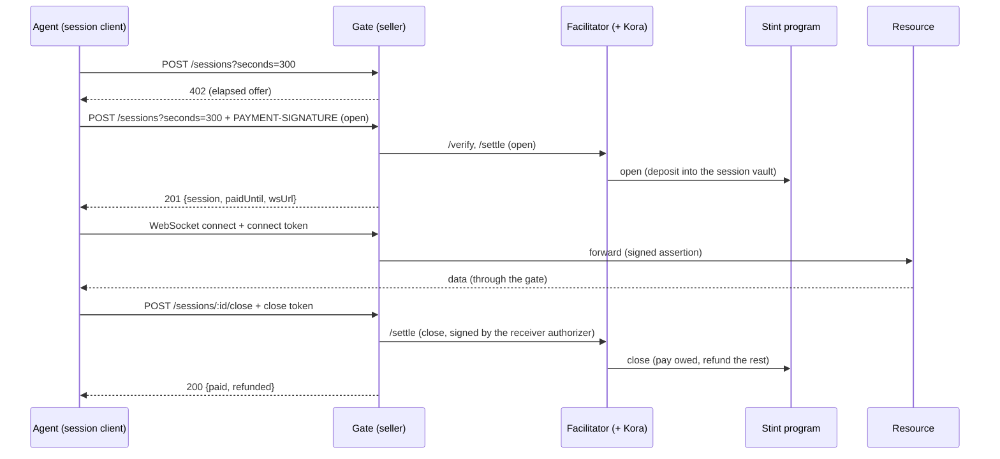

# Stint — system specification

> **Status:** draft 0.1. It describes the system to be built. The wire format of the `elapsed`
> scheme will also be published separately, in the x402 scheme format. If the two disagree, that
> document takes precedence.
>
> The key words MUST, SHOULD and MAY are used as in RFC 2119.

## 1. Overview

Stint lets AI agents **rent time on long-lived connections, and get back what they don't use**.

1. A buyer (typically an AI agent) asks a seller's service for a session and receives an HTTP 402
   response, following the x402 protocol (v2).
2. It pays once, in USDC on Solana, to open a **time-boxed session**. The payment goes into an
   escrow held by the Stint program. The seller receives nothing at this point.
3. The seller is paid **for elapsed time only**, when the session is closed or claimed.
4. When the buyer closes early, the unused remainder is refunded on-chain. When the paid time runs
   out, the connection closes.
5. The buyer can extend a session by topping it up while it runs.

The first resource served this way is a real-time stream of Solana account changes over
WebSocket. The design covers any connection that stays open for minutes or hours, such as a remote
browser.

### Guarantees

- **The seller can never receive more than the elapsed time** (with a minimum duration, set in
  the session's terms) at the session's rate.
- **The buyer's unused remainder always returns to the account it came from.** After the session
  ends, the refund needs nobody's cooperation: anyone may settle the session, and the payout
  maths is enforced by the program.
- **No intermediary holds funds.** The facilitator pays transaction fees and fronts account rent,
  but never takes custody of the payment.

### Who integrates Stint

| Integrator | What they use |
|---|---|
| A **service provider** selling a long-lived connection | The scheme package inside an existing x402 server; or the gate middleware (Node); or the gate proxy (a Docker image in front of any WebSocket service) |
| A **facilitator operator** | The scheme's facilitator mechanism; or the ready-to-run facilitator image (with Kora) |
| An **agent developer** | The session client library (with tool definitions and a CLI); or the MCP server |

Everyone shares **one deployed Stint program**, the **`elapsed` scheme specification**, and a
**conformance suite** that checks any implementation of a gate, facilitator or client.

## 2. Terms

| Term | Meaning |
|---|---|
| **Session** | One bounded use of a resource, paid in advance into escrow and settled by elapsed time |
| **Authority** | The buyer's key that controls a session: it signs payments, connection tokens and an optional unilateral close |
| **Receiver** | The seller. `payTo` is its wallet, the final payment recipient; `receiver_token` is its USDC token account |
| **Receiver authorizer** | A hot key of the seller's gate, allowed to close and claim sessions. It cannot redirect funds |
| **Rent payer** | A facilitator key that funds the session's accounts and gets the rent back when they are closed |
| **Gate** | The seller's component in front of the resource: it serves the 402, authenticates connections and enforces the session's end |
| **Facilitator** | The x402 service that verifies and settles session transactions, with Kora as fee payer |
| **Paid until** | The moment the session's deposit runs out at its rate |

## 3. Architecture

### 3.1 Components

| Component | Package / artifact | Responsibility |
|---|---|---|
| **Stint program** | `programs/stint` (Anchor) | Holds each session's escrow; pays by elapsed time; refunds the remainder |
| **Program client** | `@lxfoundry/stint-program` (generated by Codama) | Typed instructions and account decoders for `@solana/kit` |
| **`elapsed` scheme** | `@lxfoundry/stint-x402` | The x402 mechanism for client, resource server and facilitator: offers, payloads, verification, settlement |
| **Facilitator** | `apps/facilitator` and a Docker Compose stack (with Kora) | `/verify`, `/settle`, `/supported` for `elapsed`; the sweeper |
| **Gate** | `@lxfoundry/stint-gate` (middleware) and `apps/gate-proxy` (Docker image) | Sessions endpoints, connection authentication, end-of-session enforcement, resource adapters |
| **Session client** | `@lxfoundry/stint-client` | The buyer-side runtime, its tool definitions and the `stint` CLI |
| **MCP server** | `@lxfoundry/stint-mcp` | The session tools over MCP |
| **Conformance suite** | `conformance/` | End-to-end scenarios against any gate, facilitator or client |
| **Example resource** | `examples/solana-stream` | A WebSocket stream of Solana account changes |
| **Example agent** | `examples/agent` | An LLM agent that uses a session for a task |

### 3.2 Flow



### 3.3 Repository layout

```
programs/stint/            on-chain program (Anchor)
packages/program-client/   generated client (Codama, @solana/kit)
packages/x402-elapsed/     the elapsed scheme mechanism
packages/gate/             gate middleware and core
packages/client/           session runtime, tools, CLI
packages/mcp/              MCP server
apps/facilitator/          facilitator service, Compose stack with Kora
apps/gate-proxy/           gate proxy image
examples/solana-stream/    example resource
examples/agent/            example agent
conformance/               conformance suite
docs/specs/                specifications
```

### 3.4 Network and token

Devnet first. USDC on devnet is mint `4zMMC9srt5Ri5X14GAgXhaHii3GnPAEERYPJgZJDncDU` (SPL Token, 6
decimals). Only classic SPL Token mints are supported; Token-2022 is out of scope.

## 4. The Stint program

One program instance serves every seller and buyer. There is no global configuration and no seller
registry: each session records its own terms.

### 4.1 Accounts

**Session**: a PDA at seeds `["session", authority, seed]`, where `seed` is a `u64` (little-endian
bytes) chosen at random by the client. About 250 bytes.

| Field | Type | Meaning |
|---|---|---|
| `version` | `u8` | Layout version |
| `bump` | `u8` | PDA bump |
| `authority` | `Pubkey` | The buyer's controlling key |
| `seed` | `u64` | PDA seed |
| `mint` | `Pubkey` | The payment token |
| `receiver_token` | `Pubkey` | The seller's token account (of `payTo`) |
| `receiver_authorizer` | `Pubkey` | The seller's hot key |
| `refund_to` | `Pubkey` | The token account the remainder returns to |
| `rent_payer` | `Pubkey` | The account the rent returns to |
| `rate` | `u64` | Token base units per second |
| `min_seconds` | `u32` | Minimum charged duration |
| `max_seconds` | `u32` | Maximum paid duration |
| `started_at` | `i64` | Unix time at open (`Clock::unix_timestamp`) |
| `deposited` | `u64` | Total credited deposits |
| `claimed` | `u64` | Total paid to the receiver so far |

**Vault**: the associated token account of the session address for `mint`. It holds the escrowed
tokens; anyone can read its balance.

Both accounts are closed when the session closes, and their lamports return to `rent_payer`.

### 4.2 Time and amounts

All arithmetic uses checked integers with 128-bit intermediates.

```
covered    = floor(deposited / rate)                  seconds the deposit buys
paid_until = started_at + covered
end        = min(now, paid_until)
elapsed    = max(0, end - started_at)
charged    = max(min_seconds, elapsed)
owed       = min(deposited, rate × charged)
refund     = vault.amount - (owed - claimed)          at close
```

`refund` includes the rounding remainder (`deposited mod rate`) and any tokens that reached the
vault without being credited. `now` is `Clock::unix_timestamp`. The chain's clock is authoritative
for every amount.

### 4.3 Instructions

The program never transfers the buyer's tokens in `open` or `top_up`. The transaction funds the
vault with an earlier instruction (a token transfer, or an allowance pull: section 10), and the
program credits what the vault received.

**`open(seed: u64, rate: u64, min_seconds: u32, max_seconds: u32)`**

- **Signers:** `authority`, `rent_payer`.
- **Accounts:**
  - `session` (initialized here, funded by `rent_payer`);
  - `vault` (must exist, owned by `session`, mint = `mint`);
  - `mint`;
  - `receiver_token` (mint = `mint`);
  - `receiver_authorizer`;
  - `refund_to` (mint = `mint`);
  - token and system programs.
- **Checks:**
  - `rate > 0`;
  - `0 < min_seconds ≤ max_seconds`;
  - `vault.amount ≥ rate × min_seconds`;
  - `vault.amount ≤ rate × max_seconds`.
- **Effects:**
  - stores the terms and accounts;
  - `started_at = now`;
  - `deposited = vault.amount`, `claimed = 0`.
- Emits `Opened`.

**`top_up()`**

- **Signer:** `authority`.
- **Accounts:** `session`, `vault`.
- **Checks:**
  - `now < paid_until`: a session that has run out cannot be extended, so a buyer never pays for
    a gap;
  - the newly arrived amount `vault.amount - (deposited - claimed)` is greater than 0;
  - the new `deposited ≤ rate × max_seconds`.
- **Effects:** adds the newly arrived amount to `deposited`.
- Emits `ToppedUp`.

**`claim()`**

- **Signer:** none required. Anyone may call it.
- **Accounts:** `session`, `vault`, `receiver_token`, token program.
- **Effects:**
  - transfers `owed(now) - claimed` to `receiver_token`;
  - `claimed = owed(now)`.
- Emits `Claimed`.

**`close()`**

- **Signer:**
  - before `paid_until`: `authority` or `receiver_authorizer`;
  - from `paid_until` on: anyone.
- **Accounts:** `session`, `vault`, `receiver_token`, `refund_to`, `rent_payer`, token program.
- **Effects:**
  1. transfers `owed - claimed` to `receiver_token`;
  2. transfers the vault's remaining balance to `refund_to`;
  3. closes the vault and the session, returning their lamports to `rent_payer`.
- Emits `Closed`.

### 4.4 Events

| Event | Fields |
|---|---|
| `Opened` | `session`, `authority`, `rate`, `min_seconds`, `max_seconds`, `deposited`, `started_at`, `paid_until` |
| `ToppedUp` | `session`, `added`, `deposited`, `paid_until` |
| `Claimed` | `session`, `amount`, `claimed` |
| `Closed` | `session`, `owed`, `refunded`, `closed_by`, `at` |

### 4.5 Errors

`InvalidTerms`, `DepositTooSmall`, `DepositTooLarge`, `SessionExpired`, `NothingToTopUp`,
`Unauthorized`, `MintMismatch`, `AccountMismatch`, `MathOverflow`.

### 4.6 Trust properties and limits

- **The program cannot know the seller's offer.** Terms are proposed by the buyer and stored
  as signed. The facilitator (before settling) and the gate (before serving) check that a
  session's terms match the offer. A session with other terms is never served, and its buyer can
  close it.
- **`refund_to` is supplied by the client.** The session client always sets it to the account
  the funds came from. When the vault is funded through an allowance (section 10), a compromised
  authority key could point refunds elsewhere; the allowance's per-period cap bounds that
  exposure.
- **Upgrades:** the program is upgradeable on devnet, built verifiably. Before any mainnet
  deployment, its upgrade authority MUST move to a multisig or be revoked.

## 5. The `elapsed` x402 scheme

### 5.1 The offer (`PaymentRequirements`)

Standard x402 v2 fields, with the scheme's terms in `extra`.

```json
{
  "scheme": "elapsed",
  "network": "solana:EtWTRABZaYq6iMfeYKouRu166VU2xqa1",
  "amount": "150000",
  "asset": "4zMMC9srt5Ri5X14GAgXhaHii3GnPAEERYPJgZJDncDU",
  "payTo": "<receiver wallet>",
  "maxTimeoutSeconds": 60,
  "extra": {
    "paymentFlow": "escrow",
    "action": "open",
    "programId": "<stint program>",
    "rate": "500",
    "seconds": 300,
    "minSeconds": 60,
    "maxSeconds": 3600,
    "receiverAuthorizer": "<gate hot key>",
    "feePayer": "<fee payer>",
    "rentPayer": "<rent payer>",
    "recentBlockhash": "<blockhash>",
    "lastValidBlockHeight": "<height>",
    "idleCloseSeconds": 60,
    "closeOnOutage": true
  }
}
```

| Field | Meaning |
|---|---|
| `amount` | **The exact deposit** for this entry: `rate × extra.seconds`, in base units |
| `payTo` | **The final payment recipient.** The deposit goes into the session's escrow first; `payTo`'s token account receives only what `close` or `claim` pays out |
| `extra.paymentFlow` | `"escrow"`: the deposit is committed before the resource runs, and a second settlement records the final charge. In `elapsed`, that second settlement happens at close, on a later request (section 5.5) |
| `extra.action` | `"open"`, or `"topUp"` with `extra.session` set to the session address |
| `extra.rate`, `seconds`, `minSeconds`, `maxSeconds` | The session's terms |
| `extra.receiverAuthorizer` | The gate's hot key, stored in the session |
| `extra.feePayer`, `extra.rentPayer` | Published by the facilitator in `/supported`. Servers MUST copy them from there and MUST NOT hard-code them |
| `extra.recentBlockhash`, `extra.lastValidBlockHeight` | Advisory: they let a client without access to a Solana node build its transaction. `maxTimeoutSeconds` MUST NOT exceed the blockhash's validity window |
| `extra.idleCloseSeconds`, `extra.closeOnOutage` | The gate's buyer-protecting policies (section 7.5) |

Network identifiers: devnet `solana:EtWTRABZaYq6iMfeYKouRu166VU2xqa1`, mainnet
`solana:5eykt4UsFv8P8NJdTREpY1vzqKqZKvdp`.

### 5.2 Durations

- A request MAY carry `seconds` (open and top-up).
- Without it, the 402 lists **one `accepts` entry per duration** in the seller's configured menu
  (by default, `minSeconds` alone).
- With it, the 402 lists exactly that duration.
- A duration outside `minSeconds`…`maxSeconds` is refused with `400 invalid_duration`, with the
  bounds stated in the body.
- **A client cannot deposit more than the `amount` of the entry it accepts.** To pay more it asks
  for a longer duration, picks a longer entry, or tops up.

### 5.3 Actions and payloads

| Action | Initiated by | x402 handshake | Payload `type` | Transaction signed by the client |
|---|---|---|---|---|
| Open | Client | 402, then retry with `PAYMENT-SIGNATURE` | `open` | Yes |
| Top up | Client | 402, then retry with `PAYMENT-SIGNATURE` | `topUp` | Yes |
| Close | Gate, on the client's authenticated request | None: it is not a payment | `close` | No: signed by the receiver authorizer |

**Client payload** (`PAYMENT-SIGNATURE`, base64 JSON):

```json
{
  "x402Version": 2,
  "resource": { "url": "https://gate.example/sessions" },
  "accepted": { "...": "the chosen entry, exactly as received" },
  "payload": { "type": "open", "transaction": "<base64, partially signed>", "session": "<address>" }
}
```

- `accepted` MUST be the chosen entry exactly as received, byte for byte.
- `x402Version` MUST be 2.
- `payload.session` is informative: the facilitator derives the address itself.

**Transaction layouts.** The fee payer is the first account and is left unsigned. The rent payer
signs only open transactions.

| Type | Instructions, in order |
|---|---|
| `open` | [compute budget, optional] → create the vault, idempotent, funded by `rentPayer` → **exactly one** funding instruction: a `TransferChecked` from the authority's account (or one allowance pull, section 10) into the vault for exactly `amount` → `stint.open` |
| `topUp` | [compute budget, optional] → exactly one funding instruction into the vault for exactly `amount` → `stint.top_up` |
| `close` | [compute budget, optional] → `stint.close`, signed by `receiverAuthorizer` |

### 5.4 Verification (facilitator `/verify`)

`/verify` MUST be read-only: it simulates and never submits.

**Every type:**

- **Fee payer:**
  - it is `feePayer`, the first account, unsigned;
  - it appears in no instruction's accounts, and as no program.
- **Allowed programs:** compute budget, associated token account, SPL Token, Stint, and the
  allowance program (section 10).
- **Simulation** (including inner instructions):
  - the transaction succeeds;
  - the fee payer is debited only the fee;
  - the rent payer funds only the session and vault accounts.
- **Blockhash:** still valid.
- **Requirements:** compared with the requirements **issued by the resource server**, never with
  the client's echo of them.

**Per type:**

| Type | Checks |
|---|---|
| `open` | The `stint.open` terms equal `extra` (`rate`, `minSeconds`, `maxSeconds`), and `receiver_authorizer` equals `extra.receiverAuthorizer`. `receiver_token` is the token account of `payTo` for `asset`. `rent_payer` is `rentPayer`. The funding moves **exactly `amount`** of `asset` into the vault. The authority signed |
| `topUp` | The session exists and its terms match the gate's offer. The signer is its `authority`. `paid_until` is at least 10 s away, so the transaction lands before the end. The funding moves exactly `amount`. The total stays within `maxSeconds` |
| `close` | The session exists. The signer is its `receiver_authorizer` (or its `authority`, or anyone after `paid_until`) |

Refusals return `isValid: false` with one of these reasons:

| Reason | Meaning |
|---|---|
| `invalid_terms` | The terms differ from the offer |
| `insufficient_deposit` | The funding is not exactly `amount` |
| `unexpected_instruction` | An instruction outside the allowed layout |
| `session_expired` | A top-up after `paid_until` |
| `simulation_failed` | Including an exhausted allowance |
| `unknown_session` | No such session |

### 5.5 Settlement (facilitator `/settle`)

1. Re-verify.
2. The rent payer signs (`open`).
3. Kora signs as fee payer.
4. Submit, and wait for `confirmed`.

The response follows x402 v2:
- `success`, `transaction`, `network`;
- **`payer` = the session authority** (not the fee payer);
- `amount` = the amount deposited by this action;
- `settlement_pending` is a non-final `errorReason`, accompanied by a non-empty `transaction`.

Servers MUST derive the payer from the signed transaction, not from the response.

**Payment flow.** `elapsed` declares `escrow`: open is the first settlement (the deposit), close is
the second (the final charge and the refund). Unlike a single-request escrow flow, the second
settlement happens on a later request, or after expiry. So the gate drives both settlements itself
rather than through a per-request middleware flow.

**Idempotency.** A session address is unique per `(authority, seed)`, and a signed transaction
cannot land twice. A retried settlement whose transaction has already landed is reported as a
success.

### 5.6 Optional `exact` fallback

There is no x402 rule that makes clients skip a scheme they don't know. A seller MAY therefore add
a plain `exact` entry to the same `accepts` list:
- a fixed pass for a fixed duration, with `paymentFlow: "upfront"` and no refund;
- the difference stated in `resource.description`.

The gate does not build this fallback yet.

## 6. The facilitator

### 6.1 Interface

Standard x402 facilitator endpoints:

| Endpoint | Behaviour |
|---|---|
| `/verify` | As section 5.4 |
| `/settle` | As section 5.5 |
| `/supported` | Lists `{x402Version: 2, scheme: "elapsed", network, extra: {feePayer, rentPayer, programId}}` |

### 6.2 Kora

Kora runs beside the facilitator and is reachable only by it, with an API key.

- **Policy:**
  - allowed programs as in section 5.4;
  - the fee payer may not transfer SOL or tokens, create accounts, or act on token accounts;
  - a cap on lamports per transaction.
- **Pricing:** `free` (fees sponsored).
- **Several signers** MAY be configured to spread fee-payer write locks.

### 6.3 Keys and costs

| Cost | Who pays | Amount | Recovered |
|---|---|---|---|
| Transaction fees | The fee payer (Kora) | 5,000 lamports per signature. A typical session costs about 3 transactions | No (sponsored) |
| Rent for the session and vault accounts | The rent payer | `(128 + size) × lamports_per_byte` per account, read from the chain | Yes, at close |

The rent payer MAY be a pool of keys: each session records its own `rent_payer`. Keys are loaded
from the environment or a mounted volume.

### 6.4 The sweeper

The sweeper periodically lists sessions whose `rent_payer` is one of this facilitator's keys and
whose `paid_until` has passed, and closes them:
- the rent returns to the facilitator;
- the receiver is paid;
- the buyer is refunded.

It runs on one elected instance, or on all of them tolerating duplicates: a second close finds the
account gone and is skipped.

### 6.5 Packaging and configuration

A Docker Compose stack: the facilitator, Kora and a configuration template.

| Setting | Meaning |
|---|---|
| `RPC_URL`, `NETWORK`, `PROGRAM_ID` | Where and what to settle |
| Key paths | Fee-payer and rent-payer keys |
| Rate limits | Per API key and per authority |
| Seller allowlist | Optional, for hosted operators |
| Sponsorship policy | Who pays fees (sponsored by default) |

## 7. The gate

### 7.1 HTTP and WebSocket surface

| Endpoint | Purpose | Responses |
|---|---|---|
| `POST /sessions?seconds=N` | Open | `402` (offers); `201 {session, paidUntil, wsUrl}`; `400 invalid_duration` |
| `POST /sessions/:id/top-up?seconds=N` | Top up | `402`; `200 {paidUntil}` |
| `POST /sessions/:id/close` | Normal close, with a `close` token | `200 {paid, refunded, transaction}`; `401`; `404` |
| `GET /sessions/:id` | Status from the chain: `paidUntil`, deposited, earned so far, time left, a fresh blockhash | `200`; `404` |
| `GET /sessions/:id/ws` | WebSocket upgrade, with a `connect` token | Upgrade; `401`; `402` (with offers); `403`; `404`; `503` |

TLS (`https`, `wss`) is REQUIRED except on localhost.

### 7.2 The session token

A short-lived JWS, `alg: EdDSA`, signed by the session's `authority` with its Ed25519 key.

| Claim | Value |
|---|---|
| `sub` | The session address |
| `aud` | The gate's origin |
| `purpose` | `connect` or `close` |
| `iat`, `exp` | `exp` at most 120 s after `iat` |
| `jti` | A unique id |

- **Produced by:** the session client, immediately before each request that needs it. The gate
  never issues anything.
- **Required on:**
  - every WebSocket connect and reconnect (`purpose: connect`);
  - the close request (`purpose: close`).
- **Not required on:** open and top-up, which are authenticated by the signed payment transaction;
  status, which is public.
- **Carried in:** `Authorization: Bearer <token>`, or `?token=<token>` for clients that can only
  pass a URL. The gate removes it before forwarding and never logs it.
- **Gate checks:**
  1. the signature is from the session's on-chain `authority`;
  2. `aud` and `purpose` match, and `exp` has not passed;
  3. `jti` has not been seen before;
  4. the session's terms match one of the gate's offers (program, `receiver_token`,
     `receiver_authorizer`, rate, bounds);
  5. `paid_until` is more than the margin away (default 2 s).

### 7.3 Session lifecycle in the gate

- **While a session has at least one live connection**, the gate subscribes to the session
  account at `confirmed` commitment:
  - a top-up moves the end timer;
  - the account disappearing (closed by any party) drops the connections with code `4410`.
- **At `paid_until`**, by the gate's clock, the gate drops the connections with code `4402`. Then
  it closes the session on-chain as receiver authorizer, paying the receiver.
- **The gate never writes into the resource's data stream.** Clients learn the remaining time from
  `paidUntil` and the status endpoint.
- **One live connection per session** by default, configurable.

### 7.4 Close codes

| Code | Meaning |
|---|---|
| `4402` | Session expired: top up to continue |
| `4403` | Session terms do not match this gate |
| `4410` | Session closed |
| `4429` | Too many connections for this session |
| `4503` | Resource unavailable |

### 7.5 Buyer-protecting policies

Both are on by default and announced in the offer's `extra`:
- **Close on disconnect** (`idleCloseSeconds`, default 60): when no connection has returned within
  the grace period, the gate closes the session and the remainder is refunded.
- **Close on outage** (`closeOnOutage`): when the resource fails, the gate closes the session
  immediately, so the buyer is not charged for an outage.

### 7.6 Resource adapters

```ts
interface ResourceAdapter {
  provision(session: SessionInfo): Promise<Upstream>;             // e.g. start a browser
  attach(session: SessionInfo, socket: WebSocket, upstream: Upstream): void;
  teardown(session: SessionInfo, reason: EndReason): Promise<void>;
  locate?(session: SessionInfo): Promise<Upstream>;                // stateful resources only
}
```

**Middleware mode:** the gate runs in the provider's process and hands the application a verified
`SessionInfo` (`session`, `authority`, `paidUntil`).

**Proxy mode:** configuration names an upstream WebSocket URL (or pool), with optional webhooks
replacing the hooks:

| Webhook | Sent when |
|---|---|
| `onOpen` | A session is first connected |
| `onTopUp` | A top-up moves `paidUntil` |
| `onClose` | The session ends, with the reason |

### 7.7 Security between the gate and the resource

- **Network isolation:** in proxy mode the resource MUST NOT be reachable except through the
  gate (a private network, localhost or a firewall). Mutual TLS is RECOMMENDED across hosts.
- **Assertion:** on every forwarded connection, the gate adds a `Stint-Assertion` header.
  - It is a JWS signed by the gate's own Ed25519 key, with claims `session`, `authority`,
    `paidUntil`, a connection id, `aud` (the upstream) and a short `exp`.
  - Gate public keys are published as a JWKS, one key per instance.
  - The gate removes any `Stint-*` header sent by a client.
- **Events:** webhooks are signed with the same keys and carry an event id and a timestamp.
  Resources reject events older than 5 minutes, and duplicates.
- **Commands from the resource:** a private admin port on the gate (`POST
  /admin/sessions/:id/close`), authenticated by mutual TLS or a resource key, lets a resource end
  a session. The gate then closes it on-chain, and the buyer is refunded.
- **Defence in depth:** resources MAY enforce `paidUntil` from the assertion and from `onTopUp`
  themselves, and MAY read the session account on-chain instead of trusting the gate.
- **A compromised gate key** (receiver authorizer) can close sessions early and trigger claims.
  It cannot redirect funds: payouts go only to `receiver_token` and refunds only to `refund_to`.

### 7.8 Scaling

The chain is the only shared state.

| Activity | With several gate instances |
|---|---|
| Offers, open, top-up, status, closing expired sessions | Any instance can handle them |
| A live connection | Handled by the instance that holds it |
| The connection limit, `jti` replay protection, disconnect grace | Need coordination: one of the two options below |

**Coordination options:**
- **Session affinity** (RECOMMENDED): route `/sessions/:id/…` by a consistent hash of the session
  id. All three items then stay local to one instance.
- **A shared registry:** a `SessionRegistry` interface, in-memory by default, with a Redis
  implementation.

**Keys:** the receiver authorizer key is accessed through a signer interface: a local key, or a KMS
or HSM. Assertion keys are per instance and published as a JWKS.

**Stateful resources** use `locate()` to find a session's upstream again after a reconnect.

## 8. Example resource: Solana account stream

A WebSocket server behind the gate. Notifications are at `confirmed` commitment. A session may
subscribe to at most 10 accounts.

| Direction | Message |
|---|---|
| Client → server | `{"op": "subscribe", "accounts": ["<address>", …]}` · `{"op": "unsubscribe", "accounts": […]}` |
| Server → client | `{"type": "account", "address", "slot", "lamports", "owner", "data": "<base64>"}` · `{"type": "slot", "slot"}` · `{"type": "error", "code", "message"}` |

The node's endpoint and key are configured in `.env`.

## 9. Session client and agent integration

### 9.1 Requirements

- **Required:** a signer (the authority's Ed25519 key), and an HTTP and WebSocket client.
- **Not required:** access to a Solana node. Offers carry a recent blockhash.

**Optional:**

| Option | Enables |
|---|---|
| `store` (a `StateStore`: in-memory by default; file or custom) | Period budgets that survive restarts; sponsored recovery of sessions left open by a crash; a local audit log |
| `rpc` | Checking refunds on-chain after close; finding orphaned sessions at startup; unilateral close |
| SOL on the authority key | Unilateral close, independent of the gate and the facilitator |
| Allowance funding (section 10) | Period caps enforced on-chain |

### 9.2 Guarantees in every configuration

**Before signing any payment**, the client checks:
- `x402Version` 2, scheme `elapsed`, `paymentFlow: "escrow"`, the configured network;
- the program and the asset are on its allowlists, and so is the seller if a seller list is set;
- the rate is under the cap;
- `amount` fits the per-session cap and the period budget;
- `seconds` is what was requested.

It also echoes the accepted entry byte for byte, and **builds the transaction itself** from the
terms: it never signs a transaction supplied by the seller.

**During a session:**
- it tops up `topUpAheadSeconds` before `paidUntil`, only while connected and within budget;
- it reconnects with backoff, signing a fresh token each time.

**It closes** on an explicit close, when the session goes out of scope, after an idle timeout, on
error, and on process exit or signal.

**Close fallback chain:**
1. the gate's close;
2. a unilateral on-chain close, if the authority holds SOL;
3. otherwise, settlement at expiry.

### 9.3 API

```ts
const stint = createStintClient({ signer, policy, store?, rpc? });
await using session = await stint.open(url, { seconds });
const ws = await session.connect();
await session.topUp({ seconds });
const receipt = await session.close();
session.status();
```

### 9.4 Tools

Exported with strict schemas, for any tool-calling agent. They share one runtime with the MCP
server.

| Tool | Input | Output |
|---|---|---|
| `stint_open_session` | `url`, `seconds?`, `reason` | `sessionId`, `paidUntil`, cost, remaining budget |
| `stint_session_status` | `sessionId` | time left, spent, refundable now |
| `stint_top_up` | `sessionId`, `seconds` | `paidUntil`, cost |
| `stint_close_session` | `sessionId` | paid, refunded, transaction |
| `stint_send` | `sessionId`, `message` | ok |
| `stint_receive` | `sessionId`, `max?`, `timeoutSeconds`, `match?` | messages, or a timeout |

- `stint_send` and `stint_receive` are generic over any WebSocket resource.
- Tool descriptions instruct agents to close sessions as soon as their task is done.
- Policy refusals are returned as readable tool errors.

### 9.5 MCP server

`stint-mcp` serves the tools in section 9.4 over stdio. It is configured by environment variables:
the key path, caps and allowlists.

### 9.6 Example agent

A Claude (`claude-opus-5-5`) agent using the Anthropic TypeScript SDK's tool runner, at low effort.
It handles the `refusal` stop reason, with server-side fallback enabled.

**Task:** watch a devnet account until a payment arrives; report the amount and the sender; close
the session.

The agent's key path and the API key are configured in `.env`.

## 10. Allowance funding

An optional funding mode. An owner grants the agent's key a recurring delegation on the Solana
Foundation's Subscriptions & Allowances program (`De1egAFMkMWZSN5rYXRj9CAdheBamobVNubTsi9avR44`).

### 10.1 Setup

```
stint allowance grant --agent <pubkey> --per-period <amount> --period <duration> --expires <date>
stint allowance revoke
```

The grant does two things, signed by the owner:
1. it approves the program's Subscription Authority on the owner's USDC account;
2. it creates a recurring delegation for the agent's key (amount per period, period length in
   seconds, overall expiry).

SPL Token allows one delegate per token account. A dedicated USDC account for agent budgets is
RECOMMENDED.

### 10.2 Transactions

The funding instruction in `open` and `topUp` (section 5.3) is one pull from the delegation:
- from the owner's account into the vault;
- signed by the authority as delegate;
- for exactly `amount`.

In `open`, `refund_to` is the owner's account.

Facilitator checks:
- the program is the Subscriptions program;
- the delegate is the session authority;
- the destination is the vault;
- the amount equals `amount`, in `asset`;
- simulation confirms the vault receives exactly `amount`.

### 10.3 Behaviour

- **Hard cap:** the per-period cap is enforced on-chain.
- **Refunds return to the owner** but do not restore the period's allowance, so the cap bounds
  what can be **locked** per period. The client reports locked and spent amounts per period.
- **Revoking** stops new sessions and top-ups. Running sessions continue until they close.
- **Without an `rpc`,** an exhausted allowance surfaces as a refused payment
  (`simulation_failed`). With an `rpc`, the client checks it before signing.

## 11. Failure handling

| Phase | Failure | Outcome | Buyer's funds |
|---|---|---|---|
| Offer | Duration out of bounds | `400 invalid_duration` | Untouched |
| Payment | Terms or amount mismatch, unexpected instruction, failed simulation | `402` with the reason | Untouched |
| Payment | Insufficient balance, or allowance exhausted | `402` with the reason | Untouched |
| Settlement | Network error after submission | Idempotent retry | Opened or untouched, never both |
| Connect | Bad, expired, replayed or wrong-purpose token | `401` | In escrow |
| Connect | Foreign or altered terms | `403` | In escrow; the buyer can close |
| Session | Resource fails | `4503`, then the gate closes | Unused time refunded |
| Session | Client disconnects | Closed after the grace period unless it reconnects | Unused time refunded |
| Session | Gate instance fails | The client reconnects elsewhere | The session continues |
| End | Paid time runs out | `4402`, then settled | Receiver paid; remainder refunded |
| Close | Gate or facilitator unreachable | Unilateral close, or settlement at expiry | Refunded at the latest at expiry |
| Crash | The agent stops with a session open | On restart, closed via the store or a chain lookup; otherwise at expiry | Bounded by the deposit |

Funds are only ever in the buyer's account, in a session's vault, or paid out by the program's
maths.

## 12. Testing and conformance

| Layer | Tooling | Coverage |
|---|---|---|
| Program | LiteSVM, with clock control | The maths, including property tests: `owed ≤ deposited`, and every token that entered the vault leaves it exactly once (`owed + refund = deposited + uncredited`). Every signer on every instruction, before and after `paid_until`. Funding by a preceding transfer. Top-up refused after expiry. Rent return. Events |
| Scheme | Unit tests | Offer construction, payload parsing, every refusal reason, byte-for-byte echo |
| Facilitator | Surfpool (cloning the devnet USDC mint and the Subscriptions program), with Kora | Every action in both funding modes; fee-payer isolation; rent round trip; the sweeper |
| Gate | Unit tests, plus a fake upstream | Tokens, close codes, policies, assertions, events, timers |
| Client | Unit tests against a fake gate | Policy refusals, closing paths, reconnects, top-up timing, the optional store and RPC |
| End to end | The full stack on Surfpool; a smoke run on devnet | The example flow and every failure in section 11 |

**Conformance suite:** `stint-conformance --gate <url> [--facilitator <url>]`. It also has a
client mode, run against a reference gate.

| # | Scenario | Pass condition |
|---|---|---|
| 1 | Open, connect, close early | Refund = deposit − owed; the receiver receives owed |
| 2 | Close before `minSeconds` | `minSeconds` charged |
| 3 | Expiry | `4402` at `paidUntil`, then settled |
| 4 | Top-up before and after expiry | Extended; then refused |
| 5 | Wrong terms or amount | `403`, or `verify` invalid |
| 6 | Failed payment | `402`, and no session created |
| 7 | Unilateral on-chain close | Connection dropped within `confirmed` latency |
| 8 | Token: expired, wrong `aud`, wrong `purpose`, replayed | `401` each time |
| 9 | Disconnect past the grace period; reconnect within it | Closed and refunded; kept |
| 10 | Resource outage | Closed and refunded |
| 11 | Two gate instances, reconnecting elsewhere | Not closed |
| 12 | Allowance funding | Pulled from the owner; refunded to the owner; refused over the cap |

## 13. Not built

- A remote-browser resource. The adapter interface supports it.
- The `exact` fallback entry. It is specified in section 5.6.
- A shared hosted facilitator. The image makes it a deployment.
- Token-2022 mints.
- Mainnet deployment.
- A facilitator fee paid by the buyer.
- The program itself acting as allowance delegate, which would limit where an allowance can be
  spent.

## 14. To confirm during implementation

| # | Question | Fallback |
|---|---|---|
| 1 | Does `@x402/core` (TypeScript) register a third-party scheme on client, resource server and facilitator, and declare its payment flow? | Implement the v2 handshake directly: the headers `PAYMENT-REQUIRED`, `PAYMENT-SIGNATURE` and `PAYMENT-RESPONSE`, and the facilitator calls |
| 2 | Does Kora sign as fee payer for transactions where another signer (the rent payer) funds account creation inside our program? | The facilitator signs as fee payer without Kora |
| 3 | Can an allowance pull and `stint.open` share one transaction, and what are the pull instruction's exact name and accounts? | Allowance funding stays disabled; direct funding remains |
